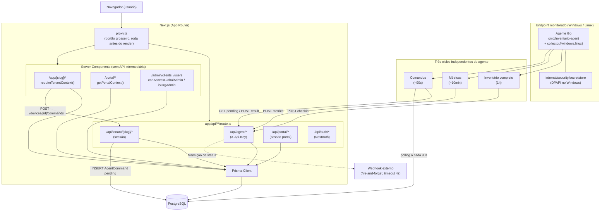
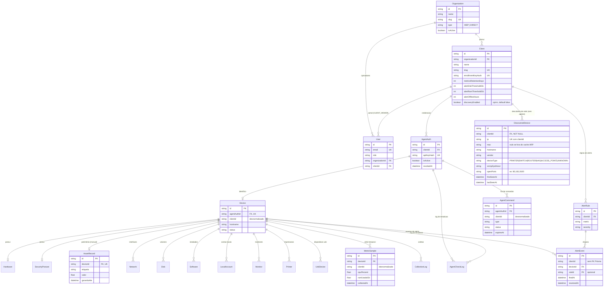

# PRODUCT.md — Inventário Enterprise

> Especificação técnica de engenharia de software do Inventário Enterprise, extraída
> diretamente do código-fonte real (`prisma/schema.prisma`, `app/api/`, `app/`, `lib/`,
> `agent-go/`, `proxy.ts`). Complementa [`PRODUTO.md`](./PRODUTO.md) — que é a fonte
> narrativa (modelo de negócio, plano de execução, como retomar uma sessão) — e
> [`SPEC.md`](./SPEC.md) — que aprofunda diagramas de sequência, contratos de API do agente e
> estratégia de segurança. Onde os três documentos descrevem o mesmo fato e divergem,
> vale o que está confirmado no código nesta versão.

---

## 1. Levantamento de Requisitos

### 1.1 Requisitos Funcionais (RF)

| ID | Requisito | Descrição |
|---|---|---|
| RF001 | Autenticação de usuários | NextAuth com `CredentialsProvider` (`auth.ts`), verificação de senha via `bcrypt.compare` contra `User.passwordHash`. Sessão carrega `id`, `role`, `organizationId`, `clientId`. |
| RF002 | Cadastro de tenant (Client) | `PLATFORM_ADMIN` ou `ORG_ADMIN` cadastra um `Client` pelo assistente `/admin/clients/novo`, via Server Action `createClientAction` (`app/admin/clients/actions.ts`). O sistema gera `enrollmentKeyHash` e exibe a chave em claro uma única vez. |
| RF003 | Enrollment de agente | O agente troca a `enrollmentKey` de uso único do `Client` por uma `apiKey` própria e permanente, gravada como `AgentAuth.apiKeyHash`, via `POST /api/agent/register`. O banco nunca guarda nenhuma das duas chaves em claro. |
| RF004 | Check-in de agente | `POST /api/agent/checkin`, autenticado por header `X-Api-Key` (`validateAgentApiKey`), payload validado por `agentCheckinSchema` (Zod) antes de tocar o banco. Ciclo de 1 hora no agente. |
| RF005 | Coleta de hardware | Tabela `Hardware` (1:1 com `Device`): sistema operacional, versão, processador, RAM total, slots de memória (1 a 4), placa-mãe, tipo de armazenamento. |
| RF006 | Coleta de rede | Tabela `Network` (1:N): IP, MAC, gateway, DNS, DHCP habilitado, indicador de interface primária. |
| RF007 | Coleta de discos | Tabela `Disk` (1:N): unidade, modelo, tipo, capacidade, espaço livre, estado de criptografia BitLocker (`"on"`/`"off"`/`"unknown"` — nunca inferido como desativado quando não apurado). |
| RF008 | Inventário de software | Tabela `Software` (1:N): nome (obrigatório), versão, editor, data de instalação. Limite de 2.000 itens por check-in. |
| RF009 | Postura de segurança | Tabela `SecurityPosture` (1:1): antivírus (nome/ativo/atualizado), firewall, Secure Boot, TPM, UAC — todos `Boolean?` de propósito, para distinguir "não apurado" de "desativado". |
| RF010 | Contas locais | Tabela `LocalAccount` (1:N): usuário, indicador de administrador, habilitada, senha nunca expira — achado central em auditorias de compliance. |
| RF011 | Métricas em série temporal | `POST /api/agent/metrics`, rota e ciclo próprios (~10 min, independentes do check-in de 1h), grava `MetricSample`: CPU%, RAM usada/total, disco usado/livre, uptime. Campos numéricos ficam nulos (não zero) quando a coleta falha. |
| RF012 | Periféricos | `Monitor` (via WMI `root\wmi`, para fabricante/serial reais), `Printer`, `UsbDevice` (deduplicado por VID+PID+serial, hubs filtrados) — todas 1:N a partir de `Device`. |
| RF013 | Patrimônio manual | `AssetRecord`, 1:1 obrigatório com `Device` (`deviceId` é `@unique`): etiqueta, nota fiscal, fornecedor, valor, garantia, centro de custo, localização, responsável, observações. Nunca escrito pelo check-in — a rota de check-in não referencia essa tabela. |
| RF014 | Alertas configuráveis | Dois mecanismos independentes: (a) limiares fixos por `Client` (disco, RAM, horas offline) que alimentam o status calculado e o webhook; (b) `AlertRule`, catálogo fechado de 5 métricas (`antivirus_inactive`, `firewall_inactive`, `uac_inactive`, `bitlocker_missing`, `software_blacklisted` — Sprint 12, única com texto livre via `AlertRule.pattern`, comparado case-insensitive contra o nome de cada software coletado no check-in), configurável pelo cliente. |
| RF015 | Ciclo de vida de alertas | `AlertEvent` abre na transição condição-ok → condição-problema (`firedAt`) e resolve na transição inversa (`resolvedAt`), sem duplicar linha enquanto o problema persiste. Não há exclusão — o histórico é permanente. |
| RF016 | Webhooks | Configurável via Server Action (`Client.alertWebhookEnabled`/`alertWebhookUrl`), disparado fire-and-forget (timeout 4s) no check-in quando o status do dispositivo transiciona de/para alerta. |
| RF017 | Comandos remotos | Catálogo fechado de 5 tipos (`lib/agent-commands.ts`): `collect_now`, `collect_metrics_now`, `restart_service` (allowlist de 4 serviços), `run_script` (allowlist de 4 scripts), `restart_computer`. Nunca texto livre — allowlist validada nos dois lados (servidor via Zod, agente via mapa espelhado). Disparo unitário (por dispositivo) ou em lote (Sprint 12, `bulkEnqueueDeviceCommandAction`, `deviceIds[]` estritamente escopados ao tenant da sessão) — mesmo catálogo, mesma validação, mesmo TTL de 15min. |
| RF018 | Dashboard por tenant | `/app/[clientSlug]`, Server Component que consulta o Prisma diretamente (sem rota de API intermediária), guardado por `requireTenantContext()`. |
| RF019 | Listagens filtráveis | `/app/[clientSlug]/computers`, `/servers`, `/storage`, `/processors`, `/network` — filtros aplicados via `searchParams`, sem API REST dedicada. |
| RF020 | Relatórios | `GET /api/tenant/[clientSlug]/reports/{csv,pdf}` e os equivalentes `/api/portal/reports/{csv,pdf}` reaproveitam a mesma consulta (`lib/reports/device-report.ts`), que agrega por contagem de máquinas por faixa (nunca soma valores absolutos entre máquinas heterogêneas). |
| RF021 | Portal do cliente | `/portal/*`, contexto derivado exclusivamente da sessão (`CLIENT_VIEWER`), nunca de slug na URL — sem parâmetro para enumerar outros tenants. Somente leitura. |
| RF022 | Auditoria | `AuditLog` registra ator, ação, tipo e id do alvo, metadados em JSON. Escrita explícita em pontos sensíveis do código (ex.: exclusão de dispositivo, emissão e resultado de comando) — não é um interceptor genérico; cobertura depende de cada ação sensível chamar `recordAuditLog()`. |
| RF023 | Gestão de usuários | `/users` é uma listagem somente leitura, escopada ao ator (`PLATFORM_ADMIN` vê todos; `ORG_ADMIN` só a própria organização) — **não há criação/edição pelo painel**; usuários nascem por `scripts/seed-rbac.ts` ou pelo bootstrap único `POST /api/auth/signup` (ver §3.7). |
| RF024 | Auto-update do agente | O agente compara sua versão contra `updateMetadata` retornado pelo check-in e só aplica um binário cujo SHA-256 confere com o anunciado pelo servidor. Fonte única do binário publicado: `public/inventario-agent.exe`. |
| RF025 | Coleta multiplataforma | Coletor Windows (WMI) e coletor Linux (`/proc`, `/sys`, `/etc/os-release`, `dpkg` para software, systemd para o serviço) — mesmos três ciclos nas duas plataformas. macOS tem apenas um stub que responde "não implementado". |
| RF026 | Webhook Endpoints por Tenant | `WebhookEndpoint` (1:N a partir de `Client`, `onDelete: Cascade`): um tenant pode cadastrar múltiplos endpoints, cada um com sua própria lista de `events` (catálogo fechado de 6 eventos — `device.offline`/`device.online`/`device.low_disk`/`device.disk_ok`/`device.warning`/`device.recovered`, `lib/webhook-endpoints.ts`) e um `secret` próprio (256 bits, gerado no servidor, nunca aceito de formulário). Cada disparo é assinado com HMAC-SHA256 do corpo (header `X-Webhook-Signature`), fire-and-forget (timeout 4s), nunca bloqueia o check-in nem a reconciliação de alertas. Coexiste sem alteração com o mecanismo RF016 (`Client.alertWebhookUrl`, único URL sem assinatura) — são dois mecanismos paralelos, não uma substituição. Guardado por `canManageTenantAlerts` (`app/app/[clientSlug]/settings`). |
| RF027 | Persistência da versão do agente | `Device.agentVersion` (`String?`), populado a partir de `body.agentVersion` no check-in (`app/api/agent/checkin/route.ts`) — o mesmo campo que já alimentava a decisão de `updateAvailable` (RF024), agora também persistido por dispositivo. Exibido no card de saúde do dispositivo (`DeviceHealth.agentVersion`, `components/device-detail-tabs.tsx`). Nulo para dispositivos que nunca fizeram check-in depois da migration que introduziu o campo. |
| RF028 | Descoberta de dispositivos na rede | Varredura **opt-in** (`Client.discoveryEnabled`, default `false`) da sub-rede /24 da interface primária de cada agente, a cada 6h (`agent-go/internal/collectors/discovery`): probe TCP em 22/80/443/445/515/631/9100 **mais** um GET SNMPv2c real em UDP/161 (`sysDescr` `.1.3.6.1.2.1.1.1.0`, `sysName` `.1.3.6.1.2.1.1.5.0`), MAC lido da tabela ARP do SO, classificação em catálogo fechado (`PRINTER`, `SWITCH`, `ROUTER`, `NAS`, `ACCESS_POINT`, `UNKNOWN`) espelhado em `lib/schemas/agent-discovery.ts`. Ingestão em `POST /api/agent/discovery` (`X-Api-Key`, `agentDiscoverySchema`), `upsert` em `DiscoveredDevice` por `(clientId, ip)` preservando `firstSeenAt`. Exibição filtrável por tipo e busca por IP/hostname/MAC em `/app/[clientSlug]/network`, seção "Dispositivos Descobertos na Rede". São dispositivos **sem** agente instalado: `DiscoveredDevice` não tem relação alguma com `Device` — é um censo de rede, não inventário. Sem ICMP/ping (exigiria raw socket): host com todas as portas sondadas fechadas e sem SNMP fica invisível, limitação aceita. |

### 1.2 Requisitos Não Funcionais (RNF)

| ID | Categoria | Requisito |
|---|---|---|
| RNF001 | Segurança | Toda comunicação do agente é autenticada por `X-Api-Key`, resolvida por hash SHA-256 exato contra `AgentAuth.apiKeyHash` — a chave em claro nunca é persistida. |
| RNF002 | Segurança | Payload de check-in e de métricas validado por schema Zod antes de qualquer escrita no banco; JSON malformado e schema inválido são registrados em `AgentCheckLog` com motivo distinto. |
| RNF003 | Segurança | Comandos remotos restritos a um catálogo fechado, sem execução de texto livre — allowlist duplicada intencionalmente em servidor e agente (defesa em profundidade), não compartilhada por um único ponto de compilação. |
| RNF004 | Isolamento multi-tenant | Chokepoint central: `requireTenantContext()` resolve o tenant pelo slug e valida `canAccessTenant()` na mesma chamada, respondendo `notFound()` — nunca `403` — para não revelar a existência de um tenant de outra organização a quem não tem acesso. Rotas de API tenant-scoped repetem o mesmo padrão de guard manualmente. |
| RNF005 | Performance | Índices compostos dimensionados para as tabelas de maior crescimento: `MetricSample` acumula ~4.300 amostras por máquina/mês, com `@@index([deviceId, collectedAt])` e `@@index([clientId, collectedAt])` desenhados para o gráfico de uma máquina e para o corte por tenant. |
| RNF006 | Disponibilidade | Check-in é parcialmente idempotente: `Device`/`Hardware`/tabelas relacionadas usam `upsert` chaveado por `agentAuthId` (reenvio não duplica estado); `CollectionLog.create()` é insert puro (reenvio gera nova linha de log, não erro). |
| RNF007 | Retenção de dados | `Client.metricsRetentionDays` (default 90) — o expurgo de `MetricSample` roda inline em toda ingestão de métrica bem-sucedida, não em job/cron separado (o projeto ainda não tem onde rodar um cron). |
| RNF008 | Usabilidade | Portal (`CLIENT_VIEWER`) tem shell e componentes próprios, sem compartilhar layout administrativo com `/app/*` — nenhum componente que aceite ações de mutação (`onDelete`, `onCommand`) entra no portal. |
| RNF009 | Auditabilidade | `recordAuditLog()` é chamado explicitamente nos pontos sensíveis identificados (exclusão de ativo, emissão/resultado de comando) — não há garantia estrutural de cobertura automática para toda ação futura. |
| RNF010 | Escalabilidade horizontal | O rate limiting (`lib/rate-limit.ts`) usa um `Map` em memória de processo — funciona por instância, não é compartilhado entre réplicas; limitação documentada explicitamente no próprio módulo. |
| RNF011 | Portabilidade | PostgreSQL é o único banco suportado, inclusive em desenvolvimento (ver ADR [0003](./adr/0003-postgresql-only.md)) — elimina a divergência entre ambiente de dev e produção que existia com SQLite. |
| RNF012 | Manutenibilidade | Nenhum `enum` existe no schema — todo campo de "estado fechado" (`role`, `status`, `severity`, `type` de comando) é `String` livre documentado por comentário, não por constraint de banco. Facilita evolução, mas não impede valores fora do conjunto esperado gravados por engano (ver RN004). |

---

## 2. Regras de Negócio (RN)

| ID | Regra |
|---|---|
| RN001 | Hierarquia real: `Organization → Client → AgentAuth → Device`. A identidade do endpoint é `Device.agentAuthId` (`@unique`, `onDelete: Cascade` a partir de `AgentAuth` — apagar a credencial apaga o dispositivo, nunca o contrário). `Device.clientId` é desnormalizado e opcional, nulo apenas para agentes legados registrados sem cliente. |
| RN002 | `Organization.type` (`MSP` ou `DIRECT`) é convenção documentada por comentário, não constraint de banco. No modo `DIRECT`, a `Organization` possui exatamente um `Client` — o mesmo caminho de código atende os dois modelos de negócio, sem ramificação `if (isMsp)`. |
| RN003 | Isolamento por tenant via `canAccessTenant`: `PLATFORM_ADMIN` sempre tem acesso; `ORG_ADMIN`/`ORG_OPERATOR` só se `user.organizationId === tenant.organizationId`; `CLIENT_VIEWER` nunca — por design, esse papel só acessa `/portal`, nunca `/app/*`. |
| RN004 | RBAC de 4 papéis (`lib/permissions.ts`, tipo `AppRole`): `PLATFORM_ADMIN`, `ORG_ADMIN`, `ORG_OPERATOR`, `CLIENT_VIEWER`. Como `User.role` é `String` livre no schema, qualquer valor fora desses 4 é normalizado para `null` por `getPermissionUser()` — ou seja, sem nenhum privilégio até correção manual. |
| RN005 | `AgentAuth.apiKeyHash` e `Client.enrollmentKeyHash` são `@unique` — apenas o hash é persistido, nunca a chave em claro, para as duas credenciais do sistema. |
| RN006 | `AlertEvent` nunca é apagado — o ciclo é aberto→resolvido por atualização de `resolvedAt`. Aplica-se apenas ao catálogo de 4 métricas de segurança; os limiares fixos de disco/RAM/offline não geram `AlertEvent` — alimentam o status calculado do dispositivo e o webhook diretamente. |
| RN007 | Disparo de comando remoto exige `canOperateTenant` (= `canManageTenant` OU `ORG_OPERATOR` da mesma organização) — `PLATFORM_ADMIN`, `ORG_ADMIN` e `ORG_OPERATOR` podem; `CLIENT_VIEWER` nunca. |
| RN008 | `Client.metricsRetentionDays` (default 90) — o expurgo é executado por `deviceId` a cada ingestão de métrica, aproveitando o índice `(deviceId, collectedAt)` já necessário para os gráficos. |
| RN009 | `AssetRecord.deviceId` é obrigatório e `@unique` — não existe "patrimônio avulso" sem `Device` associado no schema atual. |
| RN010 | O status "offline" nunca é gravado automaticamente no banco. `Device.status` bruto só muda em cada check-in; a presença exibida na tela (`getDevicePresence`, `lib/inventory-alerts.ts`) é calculada em runtime a partir do tempo desde a última coleta, em 3 níveis: **online** (até 30 min), **ausente** (até o limiar configurado de horas offline do tenant), **offline** (depois disso, ou nunca coletou). Confundir as duas colunas já foi um bug real corrigido nesta sessão de trabalho. |
| RN011 | `AuditLog` não tem função de update/delete no código, mas isso é convenção — não há constraint de banco que impeça alteração, e a cobertura depende de cada ação sensível chamar `recordAuditLog()` explicitamente (ver RNF009). |
| RN012 | `Disk.criptografia` tem 3 estados (`"on"`/`"off"`/`"unknown"`) — mesmo princípio de "não apurado ≠ desativado" usado em toda a postura de segurança, cujos campos são todos `Boolean?`. |
| RN013 | Ao agregar hardware/disco de um parque heterogêneo, o sistema sempre conta quantas máquinas caem em cada faixa/valor exato — nunca soma valores absolutos de máquinas diferentes num único número (padrão de `lib/reports/device-report.ts`, já violado e corrigido mais de uma vez no histórico do projeto). |
| RN014 | Editar `AssetRecord` usa `canManageAssetRecord`, que delega a `canOperateTenant` — mais permissivo que `canManageTenant`: `ORG_OPERATOR` também pode editar patrimônio, por ser dado operacional e não credencial. |
| RN015 | Criar `Client` usa um guard próprio (`hasClientsAdminAccess` = `isPlatformAdmin \|\| isOrgAdmin`), independente de `canManageTenant` — decisão de conta (quem pode existir), não de operação sobre um tenant já existente. **Exceção**: rotacionar a `enrollmentKey` de um `Client` já existente (`rotateEnrollmentKeyAction`) não é criação/edição de conta — é emissão de credencial para um tenant já existente, mesma natureza de `GET /api/clients/[id]/credentials` — por isso usa `canManageTenant(user, client)` (exige `organizationId` igual ao do ator), não `hasClientsAdminAccess`. |
| RN016 | Toda operação sobre `WebhookEndpoint` (criar, editar, ativar/desativar, e a consulta interna que decide para quem disparar um evento) é sempre escopada por `clientId` derivado do contexto de tenant da sessão (`getTenantContext`/`requireTenantContext`) — nunca de um `clientId` recebido como input de formulário. `secret` é gerado no servidor (`crypto.randomBytes(32)`), nunca aceito de input do usuário, e nunca devolvido em texto pleno fora do instante de criação (mascarado nas demais exibições). Guardado por `canManageTenantAlerts`, o mesmo guard de RF014(a) — ver nota de auditoria de segurança da Sprint 11 em `docs/SPRINTS.md` sobre a adequação desse guard para uma superfície que envolve enviar dados de dispositivos a uma URL externa escolhida pelo usuário. |

| RN017 | A varredura de descoberta de rede (RF028) é **opt-in por tenant e desligada por padrão** (`Client.discoveryEnabled @default(false)`). O gate que vale é **server-side e fail-closed**: `POST /api/agent/discovery` responde `202 { ok: false, reason: 'discovery_disabled' }` **sem gravar nada** quando o flag está desligado, quando o `Client` não é encontrado, e `202 { reason: 'agent_without_client' }` quando o `AgentAuth` não tem `clientId` (agente legado) — `DiscoveredDevice.clientId` é `NOT NULL`, nunca existe linha órfã. O flag também viaja na resposta do check-in (`discoveryEnabled: boolean`) para o agente não gastar um ciclo de varredura inútil, mas isso é **otimização, nunca autorização**: o agente mantém o valor só em memória de processo, com default `false` a cada início, e um agente adulterado que varra mesmo assim não consegue persistir nada. Ligar/desligar o flag exige `canManageTenantAlerts` e grava `AuditLog` (`tenant.discovery_enabled`/`tenant.discovery_disabled`) **apenas na transição**, não a cada submit do formulário. |

---

## 3. Casos de Uso — Fluxos Principais

### 3.1 Cadastro de tenant (Client)

- **Ator**: `PLATFORM_ADMIN` ou `ORG_ADMIN`.
- **Pré-condição**: ator autenticado, com sessão válida.
- **Fluxo principal**:
  1. Ator acessa `/admin/clients/novo`.
  2. Preenche nome do cliente e observações do assistente de 3 passos.
  3. Server Action `createClientAction` (`app/admin/clients/actions.ts`, guard `hasClientsAdminAccess`) cria o `Client`, vinculado à `Organization` do ator (ou à escolhida, se `PLATFORM_ADMIN`).
  4. Sistema gera `enrollmentKey` e grava apenas `enrollmentKeyHash`; a chave em claro é exibida uma única vez, em aviso de destaque.
  5. Ator segue para o passo de instalação (ver 3.2).
- **Fluxos alternativos**: ator sem `hasClientsAdminAccess` — Server Action recusa a execução.
- **Pós-condição**: `Client` ativo, `enrollmentKeyHash` gravado, pronto para receber o primeiro agente.
- **Exceções**: nome duplicado ou dados inválidos são rejeitados antes da escrita.

### 3.2 Enrollment do agente

- **Ator**: operador de TI (ou `ORG_ADMIN`/`ORG_OPERATOR` executando a instalação).
- **Pré-condição**: `Client` cadastrado com `enrollmentKey` disponível.
- **Fluxo principal**:
  1. Operador baixa o binário via `GET /api/agent/download` (ou `/api/agent/download-exe`, com `client`/`key` embutidos na query string para instalação sem digitação manual) — ambas as rotas sem autenticação de sessão, apenas rate limit por IP.
  2. Executa o agente com a `enrollmentKey` do tenant.
  3. Agente chama `POST /api/agent/register` com `{ name, client, enrollmentKey }`.
  4. Sistema valida a chave: hash da `enrollmentKey` recebida contra `Client.enrollmentKeyHash`, **ou** `X-Admin-Secret` como caminho alternativo de provisionamento.
  5. Sistema cria `AgentAuth` com `apiKeyHash` novo, vinculado ao `Client`.
  6. Resposta `201` devolve a `apiKey` em texto claro — única vez em que ela trafega assim; o agente persiste localmente (Windows: protegida por DPAPI).
- **Fluxos alternativos**: cliente não encontrado (`404`), cliente desativado (`403`), chave ausente ou inválida (`401`).
- **Pós-condição**: `AgentAuth` criado. `Device` ainda **não** existe — nasce no primeiro check-in bem-sucedido.
- **Exceções**: rate limit de 15 tentativas/5min por IP na rota de registro.

### 3.3 Check-in do agente

- **Ator**: agente Go (não há ator humano neste fluxo).
- **Pré-condição**: `AgentAuth` ativo (criado no enrollment).
- **Fluxo principal**:
  1. Agente coleta hardware, rede, discos, software, segurança, contas locais, periféricos.
  2. `POST /api/agent/checkin`, header `X-Api-Key`.
  3. Sistema resolve `AgentAuth` pelo hash da chave e valida rate limit (10/5min por `agentAuthId`).
  4. Payload validado por `agentCheckinSchema` (Zod).
  5. Sistema grava/atualiza `Device` (upsert por `agentAuthId`), `Hardware`, `SecurityPosture` (merge); recria `Network`, `Disk`, `Software`, `Monitor`, `Printer`, `UsbDevice`, `LocalAccount` (delete + insert).
  6. Em paralelo, duas pipelines de alerta independentes avaliam o resultado: limiares fixos do `Client` e o catálogo `AlertRule` de segurança.
  7. Se configurado e houve transição de status, dispara webhook fire-and-forget (timeout 4s).
  8. Grava `CollectionLog` e responde `200` com indicação de atualização de versão disponível.
- **Fluxos alternativos**: JSON malformado ou schema inválido — não altera nenhuma tabela de inventário, apenas grava `AgentCheckLog` com o motivo e responde `400`.
- **Pós-condição**: estado do `Device` reflete exatamente o payload recebido; nenhum campo de `AssetRecord` é tocado, por construção.
- **Exceções**: chave inválida/revogada (`401`/`403`); rate limit excedido (`429`, header `Retry-After`).

### 3.4 Visualização do dashboard

- **Ator**: qualquer usuário autenticado com acesso ao tenant (`PLATFORM_ADMIN`, `ORG_ADMIN`, `ORG_OPERATOR`).
- **Pré-condição**: sessão válida.
- **Fluxo principal**:
  1. Usuário acessa `/app/[clientSlug]`.
  2. `requireTenantContext(clientSlug)` resolve o tenant pelo slug e valida `canAccessTenant()` na mesma chamada.
  3. Server Component consulta o Prisma diretamente (sem rota de API intermediária).
  4. Frontend renderiza indicadores agregados (por contagem de máquinas em faixa, nunca soma) e gráficos (Recharts).
- **Fluxos alternativos**: nenhum.
- **Pós-condição**: nenhuma alteração de estado — leitura pura.
- **Exceções**: se o usuário não tem acesso ao tenant, ou o slug não existe, a chamada responde `notFound()` — nunca revela se o tenant existe para outra organização.

### 3.5 Envio de comando remoto

- **Ator**: `PLATFORM_ADMIN`, `ORG_ADMIN` ou `ORG_OPERATOR`.
- **Pré-condição**: dispositivo online/conhecido, ator com `canOperateTenant`.
- **Fluxo principal**:
  1. Ator seleciona um `Device` e escolhe um comando do catálogo fechado (`collect_now`, `collect_metrics_now`, `restart_service`, `run_script`, `restart_computer`).
  2. `POST /api/tenant/[clientSlug]/devices/[deviceId]/commands`, sessão + `canOperateTenant`.
  3. Sistema cria `AgentCommand` com status `pending` e `expiresAt` = +15 minutos; grava `AuditLog`.
  4. No próximo ciclo (~90s), agente consulta `GET /api/agent/commands/pending`; sistema expira comandos pendentes vencidos e reivindica atomicamente o mais antigo não expirado (`UPDATE ... WHERE status = 'pending'` — perder a corrida devolve `null`, evitando execução dupla).
  5. Agente valida o comando contra sua allowlist local, executa, e reporta via `POST /api/agent/commands/[id]/result`.
  6. Sistema grava resultado e novo `AuditLog`.
- **Fluxos alternativos**: sem comando pendente — resposta `{ command: null }`.
- **Pós-condição**: `AgentCommand` em estado terminal (`done`/`failed`/`expired`).
- **Exceções**: ator sem `canOperateTenant` (`403`); dispositivo inexistente (`404`); comando não reclamado a tempo expira automaticamente.

### 3.6 Configuração de alertas

Dois fluxos distintos, com guards diferentes:

**(a) Limiares fixos** (disco, RAM, horas offline, webhook)
- **Ator**: `PLATFORM_ADMIN` ou `ORG_ADMIN` (`canManageTenantAlerts`).
- **Fluxo**: abre "Configurações de Alerta" em `/app/[slug]/computers` → Server Action `saveTenantAlertSettingsAction` atualiza os campos em `Client` → passam a alimentar o status calculado e o disparo de webhook no próximo check-in.

**(b) `AlertRule` de segurança** (catálogo fechado de 4 métricas)
- **Ator**: `PLATFORM_ADMIN`, `ORG_ADMIN` ou `ORG_OPERATOR`.
- **Fluxo**: cria/edita `AlertRule` (`antivirus_inactive` | `firewall_inactive` | `uac_inactive` | `bitlocker_missing`) → em check-ins futuros, `lib/alert-rules.ts` avalia a regra → violação abre `AlertEvent` (`firedAt`); condição resolvida atualiza `resolvedAt`, sem nova linha.
- **Exceções**: ator sem `canManageTenantAlerts` não vê a opção (a); criação de `AlertRule` fora do catálogo é rejeitada pelo schema.

### 3.7 Gestão de usuários

- **Ator**: `PLATFORM_ADMIN` ou `ORG_ADMIN` (únicos papéis com acesso à rota `/users`).
- **Pré-condição**: sessão autenticada com um desses dois papéis.
- **Observação de escopo**: o painel **não implementa** criação, edição ou desativação de usuários — `/users` é uma tela somente leitura, e a própria interface avisa isso explicitamente ao ator.
- **Fluxo principal (visualização)**:
  1. `UsersPage` obtém a sessão e verifica `isPlatformAdmin(user) || isOrgAdmin(user)`; qualquer outro papel recebe `notFound()` (a rota não existe para `ORG_OPERATOR`/`CLIENT_VIEWER`, nunca `403`).
  2. Consulta `prisma.user.findMany`: `PLATFORM_ADMIN` vê todos os usuários da plataforma; `ORG_ADMIN` vê apenas usuários com `organizationId` igual ao da própria organização.
  3. Renderiza nome/e-mail, papel traduzido, escopo (cliente, senão organização, senão "Plataforma") e status (ativo/inativo).
- **Como usuários são criados na prática**: fora do painel — `scripts/seed-rbac.ts` (ambiente de desenvolvimento) ou `POST /api/auth/signup` (bootstrap único do primeiro `PLATFORM_ADMIN`, protegido por `X-Admin-Secret`, bloqueado após o primeiro uso).
- **Papéis atribuíveis** (pelo modelo, não pela UI): `PLATFORM_ADMIN`, `ORG_ADMIN`, `ORG_OPERATOR`, `CLIENT_VIEWER`.
- **Fluxos alternativos**: nenhum — não há formulário, botão de ação ou mutação nesta tela.
- **Pós-condição**: nenhuma alteração de estado.
- **Exceções**: `ORG_ADMIN` sem `organizationId` na sessão usa um filtro sentinela que resulta em lista vazia, nunca em vazamento de dados de outra organização; nenhum usuário encontrado exibe linha vazia informativa.

### 3.8 Registro de patrimônio

- **Ator**: `PLATFORM_ADMIN`, `ORG_ADMIN` ou `ORG_OPERATOR` com `canManageAssetRecord` (= `canOperateTenant`) sobre o tenant do dispositivo. `CLIENT_VIEWER` nunca tem escrita — no portal, a aba de patrimônio é fixada em modo leitura.
- **Pré-condição**: sessão com permissão de operação sobre o tenant; `Device` já existe em `/app/[clientSlug]/assets/[id]`.
- **Fluxo principal**:
  1. A página resolve o tenant (`requireTenantContext`) e calcula `canManageAsset = canManageAssetRecord(user, tenant)`, repassado ao componente de abas.
  2. A aba "Patrimônio / financeiro" só renderiza o formulário editável (`AssetRecordForm`) quando essa permissão é verdadeira; caso contrário mostra os campos em modo leitura.
  3. Campos do formulário: etiqueta, data de compra, nota fiscal, fornecedor, valor (R$), garantia até, centro de custo, localização, responsável, observações — todos opcionais, com limites de tamanho definidos em `lib/schemas/asset-record.ts`.
  4. Ao submeter, a Server Action `saveAssetRecordAction` revalida a sessão, resolve o tenant novamente e reconfirma `canManageAssetRecord` — nunca confia apenas na flag já calculada na renderização.
  5. Reconfirma que o `deviceId` recebido realmente pertence ao tenant (`prisma.device.findFirst` escopado) — nunca confia no valor vindo do formulário.
  6. Valida o payload com `assetRecordSchema.safeParse` (strings vazias viram `null`, tornando todo campo efetivamente opcional).
  7. Persiste via `prisma.assetRecord.upsert` (chave `deviceId`), gravando `updatedByUserId`.
- **Fluxos alternativos**: dispositivo sem patrimônio cadastrado ainda — formulário nasce com todos os campos nulos; primeiro envio cria o registro.
- **Pós-condição**: registro único em `AssetRecord` (1:1 com `Device`), nunca sobrescrito por uma coleta automática do agente.
- **Exceções**: sessão inválida ou permissão insuficiente → erro sem tocar o banco; `deviceId` fora do tenant informado → "Máquina não encontrada neste tenant"; falha de validação Zod → mensagem do primeiro erro exibida no formulário.

### 3.9 Portal do cliente

- **Ator**: `CLIENT_VIEWER`, vinculado a exatamente um `Client` (`user.clientId`).
- **Pré-condição**: sessão com `role = CLIENT_VIEWER` e `clientId` preenchido; `Client` e `Organization` correspondentes ativos.
- **Fluxo principal — resolução da sessão**:
  1. Toda página sob `/portal/*` chama `requirePortalContext()` → `getPortalContext()`.
  2. O cliente é derivado **exclusivamente da sessão**, nunca de um slug na URL — não existe parâmetro para enumerar outro tenant. Se o usuário não for `CLIENT_VIEWER` ou não tiver `clientId`, o contexto é `null` (inclusive para `PLATFORM_ADMIN`/`ORG_ADMIN`, que não têm portal a resolver).
  3. Busca o `Client` filtrando `id`, `isActive: true` e `organization.isActive: true`; se não encontrado, contexto é `null`.
  4. Contexto nulo → `redirect('/dashboard')`, sem mensagem específica, para não revelar se o cliente existe.
  5. O layout do portal monta um shell próprio, sem reaproveitar a `Sidebar` administrativa — nenhum componente com `onDelete`/`onCommand` entra aqui.
- **Fluxo principal — páginas**:
  - `/portal`: lista os `Device` do cliente da sessão com status, IP primário, SO, usuário logado, contagem de software e tempo desde a última coleta.
  - `/portal/devices/[id]`: `requirePortalDevice(deviceId, clientId)` restringe a busca a `{ id, clientId }` — dispositivo fora do cliente da sessão vira `notFound()`. Reaproveita `DeviceDetailTabs` com `canRunCommands={false}` (aba de comandos nem é montada) e `canManageAssetRecord={false}`.
  - `/portal/reports`: mesma consulta de agregação usada pela área operacional (`getDeviceReportRows`/`buildDeviceReportSummary`), com exportação CSV/PDF.
- **Confirmação de escopo**: nenhuma das três páginas do portal tem Server Action de mutação, exclusão, comando ou edição — apenas leitura e exportação.
- **Fluxos alternativos**: cliente sem nenhum dispositivo reportado, ou sem distribuição de SO — mensagens informativas específicas em vez de seções vazias.
- **Pós-condição**: nenhuma alteração de estado.
- **Exceções**: sessão inválida, papel diferente de `CLIENT_VIEWER`, ou cliente/organização inativos → `redirect('/dashboard')`; `deviceId` de outro cliente → `notFound()`.

### 3.10 Login

- **Ator**: qualquer usuário cadastrado em `User` (qualquer um dos 4 papéis).
- **Pré-condição**: usuário com `passwordHash` definido e `isActive = true`.
- **Fluxo principal**:
  1. Usuário submete e-mail e senha em `/login`, processado pela Server Action `loginUser`, que chama `signIn("credentials", ...)` do NextAuth.
  2. `CredentialsProvider.authorize` busca o usuário por e-mail; inexistente retorna `null`.
  3. Verifica se `role` é um `AppRole` reconhecido (`isAppRole`) — papel fora do conjunto de 4 valores é rejeitado.
  4. Verifica `isActive`.
  5. Se o usuário tem `clientId`, resolve o `slug` do `Client` associado para incluir na sessão.
  6. Compara a senha com `bcrypt.compare` contra `passwordHash`.
  7. Sucesso: grava `AuditLog` (ação `login`, não bloqueante — falha de log não impede o login) e devolve `id`, `email`, `name`, `role`, `organizationId`, `clientId`, `clientSlug` ao NextAuth.
  8. O callback `jwt` grava esses campos no token; o callback `session` os projeta em `session.user` com fail-closed explícito: token sem `role` válido resulta em sessão `CLIENT_VIEWER` (o papel de menor privilégio), nunca em um padrão mais permissivo.
- **Fluxos alternativos**: logout dispara o evento `signOut` do NextAuth, que também grava `AuditLog` (ação `logout`), sem bloquear o encerramento em caso de falha de log.
- **Pós-condição**: sessão JWT válida com `role`, `organizationId`, `clientId`, `clientSlug`, usada por toda checagem de permissão subsequente.
- **Exceções**: e-mail inexistente, senha incorreta, usuário inativo ou papel desconhecido produzem a mesma mensagem genérica ("Credenciais inválidas") — nenhuma causa é diferenciada na resposta, para não permitir enumeração de contas por tentativa e erro.

### 3.11 Descoberta de dispositivos na rede

- **Ator**: `PLATFORM_ADMIN` ou `ORG_ADMIN` (habilitação); agente instalado (execução).
- **Pré-condição**: tenant com ao menos um agente ativo; ator com `canManageTenantAlerts` sobre o tenant.
- **Fluxo principal**:
  1. Ator abre `/app/[clientSlug]/computers` → "Configurações de Alerta" → marca **Descoberta de Rede → Habilitar varredura de dispositivos na rede local** e salva.
  2. `saveTenantAlertSettingsAction` valida o formulário (Zod), reconfirma `canManageTenantAlerts`, persiste `Client.discoveryEnabled = true` e grava `AuditLog` (`tenant.discovery_enabled`) por ser uma transição do flag.
  3. No próximo check-in (até 1h), a resposta de `POST /api/agent/checkin` inclui `discoveryEnabled: true`; o agente guarda o valor em memória de processo.
  4. No tique de 6h do serviço (`discoveryTicker`), o agente calcula a /24 da interface primária, varre os hosts com 20 goroutines (probe TCP, timeout 500ms/porta) e faz um GET SNMPv2c em cada IP; lê a tabela ARP em seguida para resolver os MACs.
  5. O agente classifica cada host encontrado e envia o lote em `POST /api/agent/discovery`.
  6. A rota autentica por `X-Api-Key`, aplica rate limit (5/hora por `agentAuthId`), valida por `agentDiscoverySchema`, checa os dois gates fail-closed (RN017) e faz `upsert` por `(clientId, ip)`, preservando `firstSeenAt` e atualizando `lastSeenAt`.
  7. Ator consulta os dispositivos em `/app/[clientSlug]/network`, seção "Dispositivos Descobertos na Rede", com filtro por tipo (Todos/Impressoras/Roteadores-Switches/NAS) e busca por IP, hostname ou MAC.
- **Fluxos alternativos**: com o flag desligado (o padrão), o agente sequer varre — e se varrer (versão desatualizada, binário adulterado), a rota descarta o payload com `202` sem gravar. Host que não responde a nenhuma porta nem a SNMP não entra no inventário (não há ping). MAC ausente do cache ARP fica `null`, nunca inventado.
- **Pós-condição**: uma linha de `DiscoveredDevice` por `(clientId, ip)` com `lastSeenAt` atualizado; nenhuma alteração em `Device` ou em qualquer tabela de inventário.
- **Exceções**: payload fora do schema (IP não-IPv4, `deviceType` fora do catálogo fechado, array acima de 512, `snmpSysDescr` acima de 1024) recebe `400` e nada é gravado; pânico durante a varredura é contido por `recover()` no agente (geral e por worker) e nunca derruba o serviço nem o ciclo de check-in.

---

## 4. Modelagem de Dados

### 4.1 Inventário de entidades

24 modelos em `prisma/schema.prisma`: `Organization`, `Client`, `AgentAuth`, `Device`, `Hardware`, `Network`, `Disk`, `Software`, `CollectionLog`, `AgentCheckLog`, `AuditLog`, `SecurityPosture`, `LocalAccount`, `MetricSample`, `Monitor`, `Printer`, `UsbDevice`, `AssetRecord`, `AlertRule`, `AlertEvent`, `WebhookEndpoint`, `AgentCommand`, `DiscoveredDevice`, `User`.

(A contagem anterior deste parágrafo dizia "22 modelos" e omitia `WebhookEndpoint`, introduzido na Sprint 11 — corrigido junto com a entrada de `DiscoveredDevice` na Sprint 14.)

`DiscoveredDevice` é o único modelo de inventário que **não** descende de `Device`: descreve equipamento de terceiros na LAN, sem agente instalado (RF028).

### 4.2 Relacionamentos, cardinalidade e cascade

| Relacionamento | Cardinalidade | `onDelete` | Justificativa |
|---|---|---|---|
| `Organization → Client` | 1:N | `Cascade` | Apagar a conta contratante apaga suas empresas inventariadas — não há `Client` órfão de `Organization`. |
| `Organization → User` | 1:N | `SetNull` | Usuário pode sobreviver à organização (ex.: rebaixado a estado inconsistente para correção manual) em vez de ser apagado silenciosamente. |
| `Client → User` | 1:N | `SetNull` | Mesmo raciocínio, para `CLIENT_VIEWER`. |
| `Client → AgentAuth` | 1:N | `SetNull` (`clientId` opcional) | Uma credencial de agente pode ficar "órfã" de cliente sem que isso apague o histórico de identidade do endpoint. |
| `Client → AlertRule` | 1:N | `Cascade` | Regra de alerta não faz sentido sem o cliente dono. |
| `AgentAuth → Device` | **1:1** (`Device.agentAuthId` `@unique`) | `Cascade` (a partir de `AgentAuth`) | A credencial é a identidade real (ADR [0001](./adr/0001-device-identity-by-agentauthid.md)); apagar a credencial apaga o dispositivo, nunca o contrário. |
| `AgentAuth → AgentCheckLog` / `AgentCommand` | 1:N | `Cascade` | Histórico de tentativas e comandos não sobrevive à credencial. |
| `Device → Hardware / SecurityPosture / AssetRecord` | 1:1 cada | `Cascade` | Dados que só fazem sentido presos ao dispositivo. |
| `Device → Network / Disk / Software / LocalAccount / MetricSample / Monitor / Printer / UsbDevice / CollectionLog / AlertEvent` | 1:N cada | `Cascade` | Inventário detalhado apagado junto com o dispositivo. |
| `Device → AgentCheckLog` | 1:N (opcional) | `SetNull` | Log de tentativa de check-in pode preceder a existência do `Device` (primeira tentativa antes do primeiro upsert bem-sucedido). |
| `AlertRule → AlertEvent` | 1:N (opcional, `ruleId` `String?`) | `SetNull` | Se a regra for excluída depois do disparo, o histórico do evento permanece — só perde o vínculo com a regra viva. |
| `Client → DiscoveredDevice` | 1:N (`clientId` **obrigatório**) | `Cascade` | Censo de rede só faz sentido no contexto do cliente que o produziu. `clientId` é `NOT NULL` de propósito (diferente de `AgentAuth.clientId`/`Device.clientId`): a rota de ingestão rejeita agente sem tenant antes de qualquer escrita, justamente para nunca existir descoberta órfã, que não teria como ser escopada nem exibida. |

`AuditLog`, `MetricSample.clientId`, `AlertEvent.clientId`, `AgentCommand.clientId` e `AssetRecord.updatedByUserId` **não têm foreign key declarada no Prisma** — são colunas `String`/`String?` soltas. O isolamento nessas colunas é aplicado por convenção de consulta (sempre filtrar por elas), não por constraint de banco.

Não há relacionamento N:M no schema: um `User` pertence a no máximo uma `Organization` e um `Client` diretamente, sem tabela associativa.

### 4.3 Campos desnormalizados

| Campo | Origem | Justificativa técnica (do comentário no schema) |
|---|---|---|
| `Device.clientId` | `AgentAuth.clientId`, copiado no check-in | Evita JOIN em toda consulta de tenant; reduz o risco de vazamento por JOIN esquecido entre organizações. Opcional — nulo apenas para agentes legados sem cliente. |
| `MetricSample.clientId` | `Device.clientId` | Mesmo motivo, aplicado à maior tabela do sistema: evita JOIN em toda consulta de retenção/corte por tenant. |
| `AgentCommand.clientId` | `AgentAuth.clientId` | Permite listar/filtrar comandos por tenant sem atravessar `AgentAuth`. |

`AssetRecord` **não** tem `clientId` — apenas `deviceId` (`@unique`, obrigatório); o escopo de tenant é obtido via `Device`.

---

## 5. Requisitos de Banco de Dados

### 5.1 Constraints reais

- `@unique`: `Organization.slug`, `Client.slug`, `Client.enrollmentKeyHash`, `AgentAuth.apiKeyHash`, `Device.agentAuthId`, `Hardware.deviceId`, `SecurityPosture.deviceId`, `AssetRecord.deviceId`, `User.email`; composto: `DiscoveredDevice @@unique([clientId, ip])` — chave do `upsert` do ciclo de descoberta, garante uma linha por IP por tenant em vez de uma linha por varredura.
- Campos obrigatórios (`NOT NULL` sem default): `Device.hostname`, `Device.agentAuthId`, `AgentAuth.apiKeyHash`, `User.email`, `User.passwordHash`, `User.role`, `AssetRecord.deviceId`, `AlertRule.clientId`, `AgentCommand.expiresAt` (sem default — calculado em toda emissão de comando).
- Campos opcionais e por quê: `Device.clientId` (agentes legados sem cliente), `Device.dominio`/`usuario` (nem toda máquina está em domínio ou tem usuário logado no momento da coleta), `AgentAuth.clientId` (mesmo motivo do `Device`), `Monitor.serial`/`Disk.criptografia` (nem todo hardware reporta EDID ou tem BitLocker aplicável), todos os campos de `SecurityPosture` exceto `deviceId` (padrão "não apurado ≠ desativado", ver RN012).
- Defaults notáveis: `Organization.type = "DIRECT"`, `Organization.isActive = true`, `Client.metricsRetentionDays = 90`, `Client.alertDiskThresholdGb = 10`, `Client.alertRamThresholdGb = 4`, `Client.alertOfflineHours = 24`, `Client.discoveryEnabled = false` (o único default deliberadamente **restritivo** do schema — ver RN017), `Device.status = "online"`, `AgentCommand.status = "pending"`, `DiscoveredDevice.deviceType = "UNKNOWN"`, `User.role = "ORG_ADMIN"`.
- **Não há `enum` no schema inteiro.** Todo campo de estado fechado (`Organization.type`, `User.role`, `Device.status`, `AlertRule.severity`, `AgentCommand.status`/`type`, `Disk.criptografia`) é `String` livre, com o conjunto de valores válidos documentado só em comentário — não há `CHECK` constraint nem enum do Postgres (ver RN004 para a inconsistência real que isso já permitiu).

### 5.2 Índices e justificativa de performance

| Tabela | Índice | Motivo |
|---|---|---|
| `Client` | `[name]`, `[organizationId]` | Busca por nome; listagem por organização. |
| `AgentAuth` | `[clientId]`, `[apiKeyHash]` | Listagem por cliente; lookup de autenticação em toda requisição do agente. |
| `Device` | `[hostname]`, `[status]`, `[clientId]` | Busca por hostname; filtro por status; escopo de tenant. |
| `Network` | `[deviceId]`, `[ip]` | Junção com dispositivo; busca por IP. |
| `Disk`, `Software`, `LocalAccount`, `Monitor`, `Printer`, `UsbDevice` | `[deviceId]` (Software também `[nome]`) | Junção com dispositivo; busca de software por nome. |
| `CollectionLog` | `[deviceId]`, `[coletadoEm]` | Histórico por dispositivo; ordenação temporal. |
| `AgentCheckLog` | `[agentAuthId]`, `[deviceId]`, `[createdAt]` | Diagnóstico de tentativas de check-in por credencial, dispositivo e tempo. |
| `AuditLog` | `[actorUserId]`, `[clientId]`, `[action]`, `[createdAt]` | Consulta de auditoria por ator, tenant, tipo de ação e período. |
| `MetricSample` | `[deviceId, collectedAt]`, `[collectedAt]`, `[clientId, collectedAt]` | Índice composto desenhado especificamente para o gráfico de uma máquina (`deviceId`) e para o corte por tenant (`clientId`) na tabela que mais cresce do sistema (~4.300 amostras/máquina/mês). |
| `AlertRule` | `[clientId]` | Listagem de regras por tenant. |
| `AlertEvent` | `[clientId, firedAt]`, `[deviceId, ruleId]` | Histórico de disparos por tenant/tempo; busca por dispositivo e regra. |
| `AgentCommand` | `[agentAuthId, status]`, `[clientId, createdAt]` | Consulta de comando pendente por agente (usada no polling a cada 90s); histórico por tenant. |
| `DiscoveredDevice` | `[clientId, lastSeenAt]`, `[clientId, deviceType]`, único composto `[clientId, ip]` | Listagem da página de rede (ordenada por `lastSeenAt desc` dentro do tenant); filtro por tipo na mesma página; chave do `upsert` de cada ciclo de varredura. |
| `User` | `[clientId]`, `[organizationId]` | Escopo de usuário por cliente/organização. |

`AssetRecord` **não tem nenhum índice declarado** além do índice implícito de unicidade em `deviceId`.

### 5.3 Retenção e expurgo de `MetricSample`

`Client.metricsRetentionDays` (Int, default `90`) controla quantos dias de amostras cada tenant mantém. O expurgo roda **inline em cada ingestão de métrica bem-sucedida** (`DELETE` filtrado por `deviceId` e pela data de corte), não em job ou cron separado — decisão pragmática, já que o projeto ainda não tem onde hospedar um processo agendado. O índice `(deviceId, collectedAt)` nasceu junto com a coleta especificamente para atender essa consulta de expurgo sem varredura de tabela.

### 5.4 Estratégia append-only do `AuditLog`

`AuditLog` não possui nenhuma função de update ou delete no código — apenas `create()`. Não há, porém, constraint de banco (trigger, regra de permissão de UPDATE/DELETE) impedindo alteração; a imutabilidade é uma convenção de código, sustentada pela ausência de qualquer caminho de escrita que não seja inserção. A tabela também não tem foreign key declarada para `actorUserId`/`clientId` — sobrevive estruturalmente a qualquer exclusão em cascata de outras tabelas, por não estar ligada a nada via Prisma.

---

## 6. Arquitetura do Sistema

### 6.1 Diagrama de componentes

### 6.2 Fluxo de autenticação do agente (`enrollmentKey` → `apiKey`)

1. `ORG_ADMIN`/`PLATFORM_ADMIN` cria o `Client` → sistema gera `enrollmentKey`, grava só `enrollmentKeyHash`.
2. Agente instalado com `client` + `enrollmentKey` chama `POST /api/agent/register`.
3. Servidor confere o hash da chave recebida contra `enrollmentKeyHash` (ou aceita `X-Admin-Secret` como caminho alternativo).
4. Servidor cria `AgentAuth` com `apiKeyHash` novo (SHA-256 sem sal — chave de alta entropia gerada pelo próprio servidor, ver §4.3 de `SPEC.md`) e devolve a `apiKey` em claro **uma única vez**.
5. Toda requisição seguinte do agente (`checkin`, `metrics`, `commands/*`) usa `X-Api-Key`, resolvido por lookup exato de hash — mecanismo totalmente separado da sessão de usuário.

### 6.3 Fluxo de autenticação de usuários

1. Usuário acessa `/login` → NextAuth (`app/api/auth/[...nextauth]/route.ts`, delega a `handlers` configurados em `auth.ts`) → `CredentialsProvider` verifica `bcrypt.compare(senha, User.passwordHash)`.
2. Sessão resultante carrega `id`, `role`, `organizationId`, `clientId`.
3. **Não existe um middleware único que resolve tudo** — cada superfície de entrada revalida por conta própria:
   - Páginas `/app/[clientSlug]/*` → `requireTenantContext()`.
   - Páginas `/portal/*` → `getPortalContext()`.
   - Rotas de API tenant-scoped → `auth()` + `canAccessTenant()`/`canOperateTenant()` chamados manualmente em cada handler.
   - Rotas do agente → `validateAgentApiKey()`, mecanismo independente de sessão.

### 6.4 Middleware de resolução de tenant e isolamento multi-tenant

Dois níveis de checagem, deliberadamente distintos:

1. **Proxy (`proxy.ts`, ex-`middleware.ts` — convenção renomeada no Next.js 16)** — roda antes de qualquer rota ser renderizada, sem acesso a banco. Redireciona não-autenticado para `/login`; confina `CLIENT_VIEWER` a `/portal`; aplica `canPossiblyAccessTenantSlug` como portão grosseiro em `/app/*` (só confirma que o usuário *tem* uma `organizationId`, não que ela é dona daquele slug específico); bloqueia áreas de conta (`/admin/clients`, `/users`) e de plataforma (`/security`) por papel; redireciona 308 as URLs antigas `/tenant/[slug]/*` e `/clients` para os prefixos atuais (Sprint 5).
2. **`requireTenantContext()` (server-side, com banco)** — chokepoint definitivo: resolve o `Client` pelo slug **e** valida `canAccessTenant()` na mesma chamada, respondendo `notFound()` (nunca `403`) para não revelar a existência de um tenant de outra organização a quem não tem acesso. Usado por toda página sob `/app/[clientSlug]/*`. Rotas de API tenant-scoped repetem o mesmo padrão manualmente (`canAccessTenant`/`canOperateTenant`), sem delegar a um proxy compartilhado.

Ver ADR [0004](./adr/0004-tenant-isolation-fail-closed.md) para a decisão registrada e ADR [0001](./adr/0001-device-identity-by-agentauthid.md) para a identidade do dispositivo.

---

## 7. Matriz de Permissões (RBAC)

Validada linha a linha contra `lib/permissions.ts` e `proxy.ts`. **4 papéis confirmados, nenhum quinto** — `AppRole` (`lib/permissions.ts:9`) aceita exatamente `PLATFORM_ADMIN`, `ORG_ADMIN`, `ORG_OPERATOR`, `CLIENT_VIEWER`; qualquer outro valor de `role` é normalizado para `null` (sem privilégio algum) por `getPermissionUser`/`isAppRole`, fail-closed (RN004). O valor legado `SUPER_ADMIN` — fora do enum, usado por `app/api/auth/signup/route.ts` antes da correção da Sprint 4 — já não é gravado pelo código; citado aqui só como referência histórica do bug que RN004 existe para prevenir.

| Ação | PLATFORM_ADMIN | ORG_ADMIN | ORG_OPERATOR | CLIENT_VIEWER | Guard real |
|---|---|---|---|---|---|
| Ver todas as organizações / admin global | ✅ | ❌ | ❌ | ❌ | `canAccessGlobalAdmin` (= `isPlatformAdmin`) |
| Acessar `/app/[slug]/*` (própria org) | ✅ | ✅ (mesma org) | ✅ (mesma org) | ❌ sempre, por design | `canAccessTenant` |
| Administrar tenant (credenciais, exclusões, alertas, usuários) | ✅ | ✅ (mesma org) | ❌ | ❌ | `canManageTenant` |
| Criar/editar `Client` | ✅ | ✅ | ❌ | ❌ | `hasClientsAdminAccess` (Server Action própria, não delega a `canManageTenant`) |
| Disparar `AgentCommand` | ✅ | ✅ (mesma org) | ✅ (mesma org) | ❌ | `canOperateTenant` |
| Editar `AssetRecord` | ✅ | ✅ (mesma org) | ✅ (mesma org) | ❌ | `canManageAssetRecord` → delega a `canOperateTenant` |
| Configurar `AlertRule` / limiares / webhook | ✅ | ✅ (mesma org) | ❌ | ❌ | `canManageTenantAlerts` → delega a `canManageTenant` |
| Ver `AuditLog` do tenant | ✅ | ✅ (mesma org) | ❌ | ❌ | `canViewTenantAudit` → delega a `canManageTenant` |
| Excluir ativo (`Device`) | ✅ | ✅ (mesma org) | ❌ | ❌ | `canDeleteTenantAsset` → delega a `canManageTenant` |
| Ver navegação administrativa (sidebar) | ✅ | ✅ | ✅ | ❌ | `canViewTenantAdminNavigation` — só visibilidade, não acesso a dado |
| Acessar `/portal/*` (somente leitura) | ❌ | ❌ | ❌ | ✅ (próprio cliente) | `isClientViewer` + `getPortalContext()` |

**Notas de leitura da matriz:**
- `canViewTenantAudit`, `canDeleteTenantAsset` e `canManageTenantAlerts` são, no código, idênticas a `canManageTenant` — delegação direta, sem lógica própria adicional.
- `canManageAssetRecord` é mais permissiva do que se poderia supor por analogia: delega a `canOperateTenant`, não a `canManageTenant` — `ORG_OPERATOR` também edita patrimônio.
- Criar/editar `Client` não usa nenhuma das funções de tenant já existentes — é um guard independente, específico da área de conta.

---

## 8. APIs (Endpoints)

Inventário completo dos 22 arquivos `route.ts` sob `app/api/` (a contagem dizia "19" e a tabela omitia
`/api/tenant/[clientSlug]/devices/[deviceId]/metrics` — defasagem acumulada desde a Sprint 9, corrigida
junto com a entrada de `/api/agent/discovery` na Sprint 14). A maior parte da aplicação **não** usa uma camada de API REST para o frontend — páginas são Server Components que consultam o Prisma diretamente, e mutações usam Server Actions (`'use server'`). As rotas HTTP existem para três finalidades: **agente** (ingestão/comandos), **fluxos que exigem handler HTTP explícito** (relatórios, download de binário, status de provisionamento) e **NextAuth**.

### 8.1 Tabela resumo

| Método | Path | Autenticação | Rate limit | Finalidade |
|---|---|---|---|---|
| GET/POST | `/api/auth/[...nextauth]` | Delegado ao NextAuth | — | Login, callback, sessão, CSRF |
| POST | `/api/auth/signup` | `X-Admin-Secret` | — | Bootstrap único do primeiro `PLATFORM_ADMIN` |
| * | `/api/collect/windows` | Nenhuma (rota morta) | — | Sempre `410`, redireciona para `/api/agent/checkin` |
| GET | `/api/inventory/computers` | `X-Admin-Secret` | — | Lista estações (exclui servidores) de um tenant, para integrações admin |
| GET | `/api/clients` | Sessão + `canAccessGlobalAdmin` | — | Lista todos os clientes da plataforma |
| POST | `/api/clients` | Sessão + `canAccessGlobalAdmin` | — | Cria cliente + emite `enrollmentKey` |
| GET | `/api/clients/[id]/status` | Sessão + `canAccessOrganization` | — | Detecta o primeiro check-in, para o wizard de novo cliente |
| GET | `/api/clients/[id]/credentials` | Sessão + `canManageTenant` | — | Reexibe pacote de credenciais/provisionamento ativo |
| POST | `/api/tenant/[clientSlug]/devices/[deviceId]/commands` | Sessão + `canOperateTenant` | — | Enfileira comando remoto |
| GET | `/api/tenant/[clientSlug]/devices/[deviceId]/commands` | Sessão + `canAccessTenant` | — | Histórico dos últimos 50 comandos |
| GET | `/api/tenant/[clientSlug]/devices/[deviceId]/metrics` | Sessão + `canAccessTenant` | — | Série temporal de `MetricSample` do dispositivo (polling do card de saúde) |
| GET | `/api/tenant/[clientSlug]/reports/csv` \| `/pdf` | Sessão + `canAccessTenant` | — | Exporta inventário do tenant |
| GET | `/api/portal/reports/csv` \| `/pdf` | `getPortalContext()` | — | Exporta inventário do próprio cliente (portal) |
| POST | `/api/agent/checkin` | `X-Api-Key` | 10/5min por `agentAuthId` | Ingestão completa de inventário |
| POST | `/api/agent/metrics` | `X-Api-Key` | 20/5min por `agentAuthId` | Ingestão de amostra de métricas |
| POST | `/api/agent/discovery` | `X-Api-Key` + `Client.discoveryEnabled` | 5/hora por `agentAuthId` | Ingestão da varredura de descoberta de rede (RF028) |
| GET | `/api/agent/commands/pending` | `X-Api-Key` | 60/5min por `agentAuthId` | Polling + claim atômico de comando pendente |
| POST | `/api/agent/commands/[id]/result` | `X-Api-Key` | 30/5min por `agentAuthId` | Agente reporta resultado do comando |
| POST | `/api/agent/register` | `enrollmentKey` **ou** `X-Admin-Secret` | 15/5min por IP | Troca `enrollmentKey` por `apiKey` |
| GET | `/api/agent/bootstrap` | Nenhuma | 20/5min por IP | Gera script `.ps1` de instalação parametrizado |
| GET | `/api/agent/download-exe` | Nenhuma | 20/5min por IP | Serve `.exe` com config embutida em texto puro |
| GET | `/api/agent/download` | Nenhuma | 20/5min por IP | Serve `.exe` puro (usado pelo auto-updater) |

### 8.2 Rotas de conta e administração

**`GET/POST /api/clients`** — `GET`: `200` → `{ id, name, slug, isActive, createdAt, _count: { agents } }[]`, ordenado por nome; `401` se não `PLATFORM_ADMIN`. `POST`: request `{ name: string (min 3), slug?: string (min 3, regex ^[a-z0-9-]+$) }`; `201` → `{ id, name, slug, enrollmentKey, message }` (gera par plaintext/hash da chave e persiste o pacote de provisionamento criptografado em transação); `400` payload inválido; `409` slug já existe.

**`GET /api/clients/[id]/status`** — `200` → `{ clientSlug, agentCount, device: { id, hostname, lastSeenAt } | null }`; `401` sem sessão; `404` cliente inexistente ou fora da organização do ator (mesma resposta para os dois casos, evita enumeração). Usado em polling pelo wizard `/admin/clients/novo`.

**`GET /api/clients/[id]/credentials`** — query `?serverUrl?` (URL válida, opcional). `200` com `status: 'unavailable'` (cliente legado sem pacote persistido) ou `status: 'available'` → `{ generatedAt, package: { clientId, clientName, clientSlug, enrollmentKey, ...artifacts } }`, chave descriptografada sob demanda; toda visualização grava `AuditLog` (`credentials.view`); header `Cache-Control: no-store`; `401` sem `canManageTenant`; `404` cliente não encontrado.

**`POST /api/auth/signup`** — request `{ email, password (min 8), name? }`; `201` → `{ user: { id, email, name, role: 'PLATFORM_ADMIN', clientId: null, createdAt } }`; `401` `X-Admin-Secret` ausente/incorreto; `409` já existe um `PLATFORM_ADMIN`.

**`GET /api/inventory/computers`** — query `?clientSlug=`. `200` → array de `{ id, hostname, status, updatedAt, tenant, hardware: {...}, primaryNetwork: {...} | null, disks: [...] }`, filtrando fora sistemas operacionais classificados como servidor; `400` `clientSlug` ausente; `404` (não `401`) quando o secret é inválido — por design, para não revelar a existência da rota.

**`* /api/collect/windows`** — todo método e corpo recebem `410` com `{ error: 'Endpoint legado desativado. Use POST /api/agent/checkin com X-API-Key.' }`. Sem lógica adicional.

### 8.3 Rotas de comando e relatório (sessão de usuário, tenant-scoped)

**`POST .../devices/[deviceId]/commands`** — request: união discriminada por `type` (ver §3.4 de `SPEC.md`); `201` → `{ ok: true, command: { id, type, status } }`, grava `AuditLog` (`command.enqueue`); `403` sem sessão/tenant/`canOperateTenant`; `404` dispositivo fora do tenant; `400` payload fora do catálogo.

**`GET .../devices/[deviceId]/commands`** — `200` → `{ commands: AgentCommand[] }`, últimos 50, mais recente primeiro; guard mais permissivo que o `POST` (`canAccessTenant`, não `canOperateTenant`) — leitura é liberada a qualquer papel que veja o tenant.

**`GET .../reports/csv` e `/pdf`** (tenant e portal) — corpo é o arquivo (CSV com BOM UTF-8; PDF via `pdfkit`), `Content-Disposition: attachment`; mesma consulta-fonte (`lib/reports/device-report.ts`) reaproveitada nas 4 rotas, variando apenas o escopo (`clientSlug` da URL vs. `clientId` da sessão do portal). Rotas do portal usam `getPortalContext()` — `403` se o contexto não resolver (sem sessão `CLIENT_VIEWER` válida, ou cliente/organização inativos).

### 8.4 Rotas do agente

Contratos completos de request/response (incluindo os schemas Zod por campo) já documentados em [`SPEC.md`](./SPEC.md) §2–§3 para `register`, `checkin`, `metrics`, `commands/pending`, `commands/[id]/result` e `bootstrap` — não duplicados aqui. Duas rotas adicionais, fora do escopo de `SPEC.md`:

**`GET /api/agent/download-exe`** — query `?client=&key=` (validados só por forma: `min(2)`/`min(16)`, **nunca conferidos contra um registro real do banco nesta rota**). `200` → binário de `public/inventario-agent.exe` concatenado com um bloco de config em texto puro (`<<INV_CONFIG>>{serverUrl,client,key}<<INV_CONFIG>>`), `Content-Disposition: attachment; filename="Setup-{client}.exe"`. A validação real de `key` só ocorre depois, quando o binário instalado chama `register`. `500` se o binário fonte não existir no servidor.

**`GET /api/agent/download`** — sem parâmetros; serve o mesmo `public/inventario-agent.exe`, **sem** config embutida — consumido pelo auto-updater do próprio agente, não pela instalação inicial. `503` se o arquivo não existir (mensagem instrui rodar `make windows`).

**`POST /api/agent/discovery`** (Sprint 14, RF028) — request `{ hostname, agentVersion?, subnet?, devices: [{ ip, mac?, hostname?, vendor?, deviceType?, snmpSysDescr?, openPorts? }] }`, validado por `agentDiscoverySchema` (`ip` obrigatoriamente IPv4 em notação decimal pontuada com octetos 0–255; `deviceType` num enum estrito de 6 valores, default `UNKNOWN`; array de no máximo 512; `snmpSysDescr` de no máximo 1024). `200` → `{ ok: true, upserted: number }`. `202` → `{ ok: false, reason: 'agent_without_client' | 'discovery_disabled' }`, **sem gravar nada** (não é erro: é uma condição esperada do ciclo, e devolver 4xx faria o agente logar falha e insistir). `400` payload inválido ou JSON malformado; `401` API Key inválida; `429` acima de 5 requisições/hora por `agentAuthId`; `500` genérico. A persistência é um `upsert` por `(clientId, ip)`; `firstSeenAt` **nunca** aparece no bloco de `update`.

**Achado de simetria a registrar**: `bootstrap` e `download-exe` compartilham o mesmo desenho — nenhuma das duas rotas confere `client`/`key` contra o banco; a credencial só é validada quando o artefato gerado (script ou binário) é de fato executado na máquina alvo e chama `register`. É uma escolha deliberada documentada em comentário no código (rate limit por IP como única defesa contra varredura), não uma omissão.

---

## 9. Diagrama de Entidade-Relacionamento

`AuditLog` foi omitida do diagrama de relacionamentos por não ter nenhuma foreign key declarada no Prisma (ver §4.2/§5.4) — sobrevive estruturalmente a qualquer exclusão em cascata.

---

## 10. Glossário do Domínio

**Organization** — A conta contratante: quem loga e opera o painel. Tipo `MSP` (atende N `Client`s) ou `DIRECT` (atende só a si mesma, via exatamente um `Client`). *Evitar*: Account, Tenant, Company.

**Client** — A empresa/unidade inventariada, dona dos `Device`s. Sempre presente mesmo no modo `DIRECT` — existe uma linha redundante para não bifurcar código em `if (isMsp)`. *Evitar*: Customer, "empresa-cliente".

**Tenant** — Não é uma entidade do schema; é o conceito de isolamento aplicado a um `Client` específico (usado em código: `tenantSlug`; na URL da página operacional: `/app/[clientSlug]` — o segmento `/tenant/` do path foi removido na Sprint 5, só o identificador `tenantSlug` no código continua com esse nome). Ao falar do registro no banco, use `Client`; ao falar do escopo de acesso, "tenant" é aceitável. *Evitar*: usar "tenant" para se referir a `Organization` — são níveis diferentes da hierarquia.

**Device** — Um endpoint inventariado. Identidade real é `agentAuthId`, nunca `hostname` — hostnames colidem entre máquinas distintas (confirmado: um agente rodando em sessão WSL2 reporta o mesmo hostname da máquina Windows hospedeira). *Evitar*: tratar hostname como chave, mesmo "só para exibição".

**AgentAuth** — A credencial de uma instalação de agente, 1:1 com `Device` (`onDelete: Cascade` a partir daqui). É a unidade real de identidade/autenticação; `Device` é o que pendura dela. *Evitar*: confundir com `enrollmentKey`.

**Enrollment key vs. API key** — `enrollmentKey` é de uso único por `Client`, só para o primeiro contato (`/api/agent/register`). `apiKey` (via `AgentAuth`) é a credencial permanente de cada `Device`, usada em todo check-in depois disso. O banco nunca guarda nenhuma das duas em claro. *Evitar*: "chave do agente" sem especificar qual das duas.

**Check-in** — Requisição periódica do agente (`POST /api/agent/checkin`, ciclo de 1h) que envia o inventário completo. Distinto do ciclo de métricas (~10min) e do ciclo de comandos (~90s), que são rotas e ritmos separados.

**MetricSample** — Amostra de série temporal (CPU, RAM, disco, uptime), gravada pelo ciclo de métricas. A tabela que mais cresce do sistema — ~4.300 amostras por máquina/mês.

**AlertRule vs. limiares fixos** — Dois mecanismos de alerta distintos, não um. Limiares fixos (`Client.alertDiskThresholdGb`/`alertRamThresholdGb`/`alertOfflineHours`) alimentam o status calculado e o webhook. `AlertRule`/`AlertEvent` é um catálogo fechado e explícito, restrito a 4 métricas de postura de segurança — não cobre disco, RAM nem offline. *Evitar*: tratar "alerta" como conceito único.

**Presença (presence) vs. status** — `Device.status` é a coluna crua no banco, escrita só a cada check-in, nunca transiciona sozinha para `"offline"`. "Presença" é o valor calculado em runtime (`getDevicePresence`) a partir do tempo desde a última coleta: online (até 30 min), ausente (até o limiar do tenant), offline (depois disso, ou nunca coletou). *Evitar*: ler `device.status` direto numa tela para decidir cor de badge.

**AssetRecord** — Dado de patrimônio/financeiro, 1:1 obrigatório com `Device`, preenchido manualmente no painel. Nunca escrito pelo check-in — a rota não referencia essa tabela.

**AgentCommand** — Um comando remoto enfileirado para um `AgentAuth`, de um catálogo fechado de 5 tipos. Estados: `pending → running → done | failed | expired` (TTL de 15 minutos).

**DiscoveredDevice vs. Device** — `Device` é um endpoint COM agente instalado, que faz check-in e tem inventário completo. `DiscoveredDevice` é um equipamento de rede SEM agente (impressora, switch, NAS), visto de fora pela varredura de descoberta (RF028): só IP, MAC, portas abertas e o que o SNMP contar sobre si. As duas tabelas **não se relacionam** — um mesmo IP pode aparecer em `Network` (de um `Device`) e em `DiscoveredDevice` sem qualquer vínculo modelado. *Evitar*: chamar de "dispositivo descoberto" uma máquina com agente; *evitar*: tentar "promover" um `DiscoveredDevice` a `Device`.

**Varredura de descoberta (network discovery)** — O ciclo de 6h, opt-in por tenant (RN017), em que o agente sonda a própria /24. Não usa ping/ICMP (exigiria raw socket): "vivo" é definido por responder a um probe TCP ou a um GET SNMP. *Evitar*: chamar de "scan de rede" sem qualificar — o termo sugere varredura ativa irrestrita, e esta é limitada à /24 local, a 7 portas TCP e a um GET SNMP somente leitura.

**Bucket (nunca soma)** — Ao agregar hardware/disco de um parque heterogêneo, sempre contar quantas máquinas caem em cada faixa/valor exato — nunca somar valores absolutos de máquinas diferentes. *Evitar*: `sum(ramTotalGb)` ou equivalente em qualquer tela que agregue hardware por tenant.

**Presença de segurança "não apurado ≠ desativado"** — Todo campo booleano de `SecurityPosture` (e `Disk.criptografia`) é opcional/nulável de propósito: `null` significa que o agente não conseguiu apurar o dado (ex.: Windows Server sem o namespace `SecurityCenter2`), nunca que a proteção está desligada.

---

## Cobertura deste documento

**Lido integralmente para esta versão**: `prisma/schema.prisma`, `lib/permissions.ts`, `proxy.ts`, `app/admin/clients/actions.ts`, `lib/inventory-alerts.ts` (função de presença), `CONTEXT.md`, `docs/PRODUTO.md`, `docs/SPEC.md`, `docs/adr/*`, estrutura de diretórios de `agent-go/`, os 19 arquivos `route.ts` sob `app/api/`, `lib/auth.ts`, `lib/rate-limit.ts`, `lib/schemas/agent-checkin.ts`, `lib/schemas/agent-metrics.ts`, `lib/agent-commands.ts`, `lib/portal-context.ts`, `auth.ts`, `auth.config.ts`, `app/login/page.tsx`, `app/login/actions.ts`, `app/users/page.tsx`, `components/asset-record-form.tsx`, `app/app/[clientSlug]/assets/[id]/actions.ts`, `lib/schemas/asset-record.ts`, `app/portal/page.tsx`, `app/portal/layout.tsx`, `app/portal/devices/[id]/page.tsx`, `app/portal/reports/page.tsx`, `app/api/auth/signup/route.ts`.

**Não lido nesta passada**: código Go do agente além da estrutura de diretórios e do que já está documentado em `docs/PRODUTO.md` §6; `lib/reports/device-report.ts` (consumido por referência, não lido linha a linha nesta revisão); `lib/provisioning-credentials.ts` além do que `SPEC.md` já documenta.
