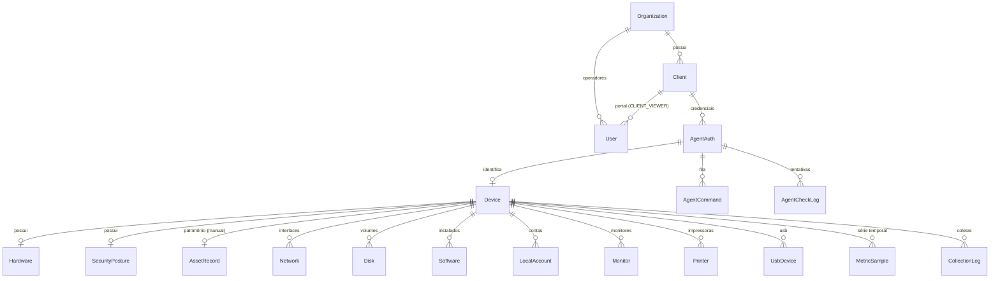

# Produto — Requisitos, Arquitetura e Plano de Execução

Documento de referência do Inventario Enterprise. Define **o que o sistema é**, **o que coleta**, **como os dados se relacionam**, **quais páginas existem** e **em que ordem construir**.

> **Este é o documento narrativo** (modelo de negócio, decisões, plano de execução, como retomar
> uma sessão) — é o que se lê primeiro, e é atualizado a cada entrega relevante. Para o catálogo
> formal de requisitos (RF/RN), casos de uso detalhados, constraints/cascades completos do schema,
> matriz RBAC validada e inventário de rotas de API, ver [`PRODUCT.md`](./PRODUCT.md). Para
> diagramas de sequência, contratos de API do agente e estratégia de segurança, ver
> [`SPEC.md`](./SPEC.md). Onde os três documentos descrevem o mesmo fato e divergem, este
> (`PRODUTO.md`) vence — os outros dois são derivados dele e do código.

---

## 1. Modelo de negócio

O sistema atende **dois modelos ao mesmo tempo**:

| Modelo | Quem contrata | O que enxerga |
|---|---|---|
| **MSP / prestador de TI** | Uma empresa de TI que atende vários clientes | Todas as empresas-cliente que ela atende |
| **SaaS direto** | Uma empresa que quer inventariar a si mesma | Apenas o próprio parque |

### Consequência arquitetural

Isso exige **um nível hierárquico que hoje não existe**. Hoje o topo é `Client`, o que não distingue "quem paga/opera" de "quem é inventariado".

Solução: introduzir **`Organization`** acima de `Client`.

```
Organization  (conta contratante — quem loga e opera)
   │  type: MSP | DIRECT
   │
   ├── User            (operadores da conta)
   │
   └── Client          (empresa inventariada / unidade)
         ├── User      (portal self-service do cliente)
         └── AgentAuth (1 credencial por agente instalado)
               └── Device
```

- **MSP**: `Organization(type=MSP)` → N `Client`
- **SaaS direto**: `Organization(type=DIRECT)` → exatamente 1 `Client` (ela mesma)

> **Por que não tratar o modelo direto sem `Client`?** Porque manteria dois caminhos de código para tudo abaixo (device, métricas, relatórios, comandos). Com o `Client` sempre presente, existe **um único caminho de escopo** — o custo é uma linha redundante no modo direto, e o ganho é não ter `if (isMsp)` espalhado pelo sistema.

---

## 2. Papéis e permissões

| Papel | Escopo | Pode |
|---|---|---|
| `PLATFORM_ADMIN` | Global (você, dono da plataforma) | Gerenciar Organizations, ver auditoria global |
| `ORG_ADMIN` | Uma Organization | Gerenciar clients, usuários, chaves, alertas, comandos |
| `ORG_OPERATOR` | Uma Organization | Ver tudo da org e **disparar comandos**; não gerencia usuários nem credenciais |
| `CLIENT_VIEWER` | Um Client | Portal self-service **somente leitura** |

> `ORG_OPERATOR` existe para separar "quem administra a conta" de "quem executa ação remota na máquina do cliente" — hoje qualquer `CLIENT_ADMIN` teria poder irrestrito de execução remota, o que é risco desnecessário.

**Migração dos papéis atuais:** `SUPER_ADMIN` → `PLATFORM_ADMIN`; `CLIENT_ADMIN` → `ORG_ADMIN`.

---

## 3. O que o inventário coleta

### 3.1 Já coletado hoje
- **Identificação**: hostname, serial, fabricante, modelo, domínio, usuário logado
- **Hardware**: SO, versão, processador, RAM total, slots de memória, placa-mãe
- **Rede**: IP, MAC, gateway, DNS, DHCP, interface primária
- **Disco**: unidade, modelo, tipo, capacidade, espaço livre
- **Software**: nome, versão, editor, data de instalação

### 3.2 Segurança / compliance *(novo)*
O que mais pesa em auditoria e é o principal argumento de venda B2B.

- Antivírus: nome, ativo?, assinaturas atualizadas?
- Firewall ativo por perfil
- Criptografia de disco (BitLocker) por volume
- Secure Boot, TPM presente, UAC ativo
- **Atualizações pendentes**: KB, título, severidade — **ainda não implementado**, ver risco em §10
- **Contas locais**: usuário, é administrador?, ativo?, último logon, senha nunca expira

### 3.3 Uso ao longo do tempo *(novo)*
Série temporal para gráficos e detecção de máquina saturada.

- CPU %, RAM usada/total, disco usado/livre, uptime
- Amostragem a cada ~10 min, **retenção padrão de 90 dias**

> Esta é a tabela que mais cresce: ~4.300 amostras/máquina/mês. Exige índice `(deviceId, collectedAt)`, política de expurgo e é a principal razão para sair do SQLite.

### 3.4 Periféricos *(novo)*
- **Monitores**: fabricante, modelo, serial, polegadas, conexão, ano
- **Impressoras**: nome, porta, driver, padrão?, é de rede?
- **Dispositivos USB**: nome, vendorId, productId, serial

### 3.5 Patrimônio / financeiro *(novo — entrada manual, não coletado)*
- Etiqueta de patrimônio, data de compra, nota fiscal, fornecedor, valor
- Garantia até, centro de custo, localização, responsável, observações

> Estes campos **não vêm do agente** — são preenchidos no painel e nunca podem ser sobrescritos por um check-in.

---

## 4. Modelo relacional

### 4.1 Diagrama



### 4.2 Invariantes que não podem ser violadas

1. **Identidade do endpoint é `agentAuthId`**, nunca `hostname` (hosts colidem entre clientes).
2. **Todo dado de inventário pertence a exatamente um `Client`**; toda consulta é escopada por ele.
3. **Segredos nunca ficam em claro no banco.** A `apiKey` de cada agente só existe em plaintext na
   emissão, e o banco guarda apenas o hash. A `enrollmentKey` do `Client` também é conferida por
   hash, mas o banco guarda uma cópia cifrada (AES-256-GCM) para que quem administra o cliente
   (`canManageTenant`) possa consultá-la de novo; cada consulta grava `credentials.view` no
   `AuditLog` (ADR 0005).
4. **Dados manuais (`AssetRecord`) jamais são sobrescritos pelo check-in.**
5. **Um `Client` pertence a exatamente uma `Organization`.**

### 4.3 Decisão: desnormalizar `clientId` no `Device`

Hoje o isolamento é `Device → AgentAuth → Client`, ou seja, **um JOIN em toda consulta**. Com as tabelas novas (métricas, monitores, updates), isso vira JOIN duplo em tabelas grandes.

**Decisão**: gravar `clientId` diretamente em `Device`, `MetricSample` e `AgentCommand`, indexado.

- *Custo*: redundância controlada, preenchida no check-in.
- *Ganho*: toda query de tenant vira índice simples; reduz risco de vazamento entre tenants por JOIN esquecido.

---

## 5. Páginas do site

As 7 páginas globais que eram apenas `redirect('/clients')` já foram removidas (ver A3).

**Estado real das rotas (Sprint 5, 2026-08-31)**: `/tenant/[clientSlug]/*` foi renomeado para
`/app/[clientSlug]/*` e `/clients` para `/admin/clients` — puro rename, preservando a estrutura
atual centrada em `Client` (URLs antigas respondem 308). As tabelas 5.1/5.2 abaixo descrevem uma
reestruturação de navegação **maior e ainda não implementada** — `/admin/organizations` (girando
em torno de `Organization`, não de `Client`) e um `/app/devices` consolidado entre clientes de uma
mesma organização — registrada como discrepância na Sprint 5 e deixada como decisão em aberto: se
vira sprint própria ou se esta seção é revisada para refletir o rename mais simples que já existe.
Não confundir o nome-alvo destas tabelas com o path real hoje.

### 5.1 `/admin/*` — Plataforma (`PLATFORM_ADMIN`)
| Rota | Função |
|---|---|
| `/admin/organizations` | Criar/listar/desativar contas (MSP ou direta) |
| `/admin/organizations/[id]` | Detalhe, plano, limites, usuários |
| `/admin/audit` | Auditoria global de todas as contas |

### 5.2 `/app/*` — Operação (`ORG_ADMIN`, `ORG_OPERATOR`)
| Rota | Função |
|---|---|
| `/app` | Dashboard da conta: total de máquinas, online/offline, alertas, saúde |
| `/app/clients` | Lista de clientes (MSP: vários; direto: 1) |
| `/app/clients/[slug]` | Visão do cliente + provisionamento (chave, instalador, agentes) |
| `/app/devices` | Inventário consolidado com filtros (disco baixo, RAM baixa, sem coleta há X dias, SO, antivírus inativo) |
| `/app/devices/[id]` | **Abas**: Visão geral · Hardware · Software · Segurança · Métricas · Periféricos · Patrimônio · Comandos |
| `/app/commands` | Fila e histórico de comandos da conta |
| `/app/reports` | Geração/exportação CSV e PDF |
| `/app/alerts` | Regras de alerta e histórico de disparos |
| `/app/settings` | Usuários, webhooks, limiares, retenção de métricas |
| `/app/audit` | Auditoria da conta |

### 5.3 `/portal/*` — Cliente final (`CLIENT_VIEWER`, somente leitura)
| Rota | Função |
|---|---|
| `/portal` | Resumo do próprio parque |
| `/portal/devices` | Lista das próprias máquinas |
| `/portal/devices/[id]` | Detalhe **sem** comandos, **sem** credenciais, **sem** auditoria |
| `/portal/reports` | Baixar relatórios do próprio parque |

> O portal é uma **superfície de ataque separada**: não deve compartilhar layout nem componentes que exponham ações administrativas. Regra: se um componente aceita `onDelete`/`onCommand`, não entra no portal.

---

## 6. O agente

### 6.1 Como funciona
1. Admin cria o `Client` → sistema gera `enrollmentKey`
2. Instalador é baixado já com `serverUrl + client + key` embutidos
3. Na instalação, o agente chama `POST /api/agent/register` e recebe uma `apiKey` **única e irrepetível**
4. `apiKey` é gravada localmente protegida por **DPAPI** (machine-local)
5. Roda como **serviço Windows** (`LocalSystem`), com três ciclos independentes

### 6.2 Ciclos
| Ciclo | Intervalo | O que faz |
|---|---|---|
| Inventário completo | 1 h | Hardware, software, rede, disco, segurança, periféricos |
| Métricas | ~10 min | Amostra leve de CPU/RAM/disco (série temporal) |
| Comandos | 90 s | Pergunta se há comando pendente, executa, reporta |

### 6.3 Canal de comandos ("tool calling")
Servidor enfileira → agente busca no próximo ciclo → executa → reporta resultado.

- Estados: `pending → running → done | failed | expired` (TTL 15 min)
- **Catálogo fechado**, sem texto livre: `collect_now`, `collect_metrics_now`, `restart_service`
  (allowlist de serviços), `run_script` (allowlist de scripts), `restart_computer`
- Allowlist validada **nos dois lados** (servidor via Zod, agente via mapa) — defesa em profundidade
- Toda emissão e todo resultado geram registro de auditoria
- Rate limiting por `agentAuthId` nas rotas do agente (`lib/rate-limit.ts`), em memória de
  processo — protege contra um agente comprometido inundando a ingestão

### 6.4 Segurança do agente
- Segredo local protegido por DPAPI
- Auto-update **só aplica binário cujo SHA-256 confere** com o informado pelo servidor
- Pendente: assinatura Authenticode (remove aviso de "fornecedor desconhecido")
- ✅ Fonte única do binário: `public/inventario-agent.exe`, publicado por `npm run
  build:agent` (ou `make windows` em `agent-go/`, para quem tem `make`)

### 6.5 Plataformas
- **Windows**: suportado
- **Linux ✅ Suportado.** Coleta via `/proc`, `/sys` e `/etc/os-release` — sem WMI, sem
  dependência externa além de `dpkg` (Debian/Ubuntu) para a lista de software. Serviço via
  systemd (`inventario-agent install` escreve a unit, não um timer+oneshot como o script
  antigo em `scripts/agent/install-linux-agent.sh`) — processo persistente com os mesmos
  três ciclos do Windows (inventário 1h, métricas 10min, comandos 90s), não uma execução
  horária isolada. Postura de segurança e periféricos ficam de fora desta primeira versão
  (exigem detecção específica de distro: ufw/iptables, CUPS, lsusb) — campos ficam ausentes,
  nunca inventados. Testado de ponta a ponta em WSL2 Ubuntu 24.04 real (não só cross-compile):
  `install` → registro → systemd → check-in completo → métricas, com e sem privilégio de
  root (afeta só se `/etc/shadow` é lido para status de conta local).

  Para reproduzir: `cd agent-go && GOOS=linux GOARCH=amd64 go build -o dist/inventario-agent-linux ./cmd/inventario-agent`,
  copiar para dentro do WSL/Linux, `sudo ./inventario-agent-linux install -server <url> -client <slug> -key <chave>`.
- **macOS**: não suportado — só o stub (`factory_stub.go`) responde "coletor nativo ainda
  não implementado"

---

## 7. Como o cliente fica vinculado

Fluxo definido: **admin cria manualmente**.

1. `ORG_ADMIN` cria o `Client` no painel → `enrollmentKey` exibida; ela vale até ser rotacionada e
   pode ser consultada de novo em "Ver credenciais" por quem administra o cliente (ADR 0005)
2. Baixa o instalador personalizado daquele cliente
3. Instala nas máquinas (manual, GPO, Intune ou script de bootstrap)
4. Cada máquina vira um `AgentAuth` + `Device` vinculados àquele `Client`
5. Opcional: `ORG_ADMIN` cria um usuário `CLIENT_VIEWER` para o cliente acessar o portal

**Não haverá auto-cadastro/trial nesta fase** — evita billing, verificação de e-mail e antiabuso.

---

## 8. Plano de execução

Ordenado por dependência: cada fase evita retrabalho da seguinte.

### Fase A — Fundação *(bloqueante; nada novo antes disso)*

**A1. PostgreSQL + Docker ✅ Concluído**
PostgreSQL 16 via `docker compose up -d db`; provider trocado e 829 registros
migrados do SQLite (1 organização, 1 cliente, 4 usuários, 7 agentes, 3 máquinas,
429 softwares, 352 logs de coleta, 18 de auditoria) sem órfãos. O SQLite anterior
ficou preservado em `prisma/dev.db.backup-pre-postgres`.

**A2. Hierarquia `Organization` + RBAC de 4 papéis ✅ Concluído**
`Organization → Client → AgentAuth → Device`; papéis `PLATFORM_ADMIN`, `ORG_ADMIN`,
`ORG_OPERATOR`, `CLIENT_VIEWER`; `clientId` desnormalizado em `Device`;
autorização de tenant concentrada em `requireTenantContext` (fail-closed, responde
`notFound()` para não revelar tenant de outra organização).

**A3. Consolidação de rotas ✅ Concluído (Sprint 5, 2026-08-31)**
Feito: removidos 7 stubs mortos (`/computers`, `/network`, `/processors`, `/servers`,
`/storage`, `/reports`, `/assets/[id]`), `/settings` (fingia salvar), e substituídos os
dados fabricados de `/users` e `/security` por dados reais. `/tenant/[clientSlug]/*` renomeado
para `/app/[clientSlug]/*` e `/clients` para `/admin/clients`, com redirect 308 das URLs antigas
e lint real ativo sobre `app/**`/`components/**`/`lib/**`. A reestruturação maior de navegação
descrita em §5.1/§5.2 (`/admin/organizations`, `/app/devices` consolidado) continua fora de
escopo — ver nota em "5. Páginas do site".

### Fase A4 — Redesenho do frontend *(direcionado, não reconstrução)*

A base atual (Tailwind v4 + shadcn/ui + Radix) **fica** — o problema não é o design system, é a **disposição e o fluxo** de telas específicas.

**Prioridade 1 — Criação/provisionamento de agente. ✅ Implementado** (`/admin/clients/novo`).

O problema era despejar seis caminhos de instalação simultâneos (chave, comando bootstrap, .exe, PS1, comando manual, "abrir script") sem hierarquia, sem destacar que a chave só aparece uma vez, e sem nunca confirmar se a máquina conectou.

Fluxo novo, em 3 passos com estado explícito:
1. **Dados do cliente** — nome + endereço do servidor, com explicação do que o endereço significa
2. **Instalação** — download do `.exe` como ação única em destaque (a config vai embutida, não exige digitar nada); chave em aviso âmbar de exibição única; PowerShell/manual recolhidos em "outras formas de instalar", para GPO/Intune
3. **Primeira máquina** — a tela consulta `GET /api/clients/[id]/status` a cada 5s e vira "«hostname» conectou" quando o primeiro check-in chega; fecha o ciclo que antes ficava em aberto

**Prioridade 2 — Detalhe da máquina. ✅ Implementado.** Seis abas (Visão geral ·
Hardware · Software · Segurança · Rede · Comandos). O software coletado
(121–174 por máquina) não era exibido em lugar nenhum e agora tem aba com busca.

**Prioridade 3 — Navegação. ✅ Implementado.** Sidebar por papel, com usuário real
no rodapé. Corrigido um fail-open: a versão anterior liberava o menu administrativo
completo quando o papel **não** era reconhecido.

**Prioridade 4 — Portal do cliente. ✅ Implementado** (ver C1).

**Prioridade 5 — Tipografia. ✅ Corrigido.** O CSS apontava para `'Geist'`, fonte que
nunca era carregada, e a pilha não tinha fallback genérico — o navegador caía na
serifada padrão. Agora Inter (UI) + JetBrains Mono (valores técnicos) via `next/font`,
números tabulares e tracking negativo em títulos.

**Modal "Credenciais ativas" ✅ Redesenhado.** Mesmo padrão do assistente `/admin/clients/novo`
(botão primário + chave em caixa de aviso + "outras formas de instalar" recolhido),
com `CopyField` extraído para componente compartilhado entre os dois pontos de entrada.

> Manter: paleta, componentes shadcn/ui. Trocar: disposição, densidade, fluxo de tarefa.

### Fase B — Coleta ampliada
Cada item = schema + coletor Go + tela. Ordem por relação valor/esforço:

- **B1. Segurança/compliance ✅ Concluído.** Antivírus, firewall, Secure Boot, TPM,
  UAC, BitLocker por volume e contas locais. Regra que atravessa as três camadas:
  `null` = "não apurado", nunca "desativado" (`*bool` no Go, `nullable` no Zod,
  coluna opcional, três estados na UI). Trata Windows Server sem SecurityCenter2,
  BitLocker ausente e controlador de domínio sem contas locais.
  **Não coletado ainda**: atualizações pendentes (exige a API do Windows Update Agent).
- **B2. Métricas / série temporal ✅ Concluído.** Ciclo novo no agente (~10 min,
  independente do inventário completo de 1h): CPU%, RAM usada/total, disco usado/livre
  da unidade do sistema, uptime. Índice `(deviceId, collectedAt)` e expurgo por
  retenção (`Client.metricsRetentionDays`, padrão 90 dias) nasceram junto com a
  coleta — o expurgo roda a cada ingestão (`DELETE` indexado por `deviceId`), não em
  job separado, porque o projeto ainda não tem onde rodar um cron. Aba "Métricas" com
  gráficos reais (recharts) em `/app/.../assets/[id]` e no portal.
- **B3. Periféricos e monitores ✅ Concluído.** Monitores via `WmiMonitorID` (namespace
  `root\wmi` — `Win32_DesktopMonitor` não tem fabricante/serial reais), impressoras via
  `Win32_Printer`, USB via `Win32_PnPEntity` filtrando hubs e deduplicando por
  VID+PID+serial. Roda no ciclo de inventário completo (1h), não no de métricas.
- **B4. Patrimônio ✅ Concluído.** Só formulário — `AssetRecord` nunca é tocado pelo
  check-in, por construção (a rota de checkin não sabe que a tabela existe). Editável
  por quem tem `canManageAssetRecord` (= `canOperateTenant`: ORG_ADMIN + ORG_OPERATOR,
  dado operacional, não credencial); somente leitura no portal.

### Fase C — Valor operacional
- **C1. Portal do cliente ✅ Concluído.** `/portal` deriva o cliente da **sessão**,
  nunca da URL — sem slug não há o que enumerar. Shell próprio, que não importa a
  Sidebar de operação. `CLIENT_VIEWER` foi removido de `canAccessTenant`: a separação
  vale nos dois sentidos, para não manter duas regras de autorização em sincronia.
- **C2. Relatórios CSV/PDF ✅ Concluído.** CSV sem dependência (geração direta, com BOM
  UTF-8 explícito pra acentuação não quebrar no Excel). PDF via `pdfkit` (nova
  dependência) — precisou `serverExternalPackages: ['pdfkit']` no `next.config.mjs`
  porque o webpack do Next quebra a leitura dos arquivos `.afm` de fonte que a lib lê
  do disco em runtime. Mesma consulta (`lib/reports/device-report.ts`) reaproveitada
  por `/app/[clientSlug]/reports` e `/portal/reports` (rota nova).
- **C3. Alertas por regra ✅ Concluído.** Catálogo fechado de 4 métricas sobre a
  postura de segurança de B1 (antivírus/firewall/UAC/BitLocker — até então só
  visíveis passivamente na aba Segurança). Cliente cria quantas `AlertRule`
  quiser; `AlertEvent` fica aberto (`resolvedAt` nulo) até a próxima coleta
  confirmar a condição resolvida — sem duplicar linha a cada check-in enquanto
  o problema persiste. Aditivo: os 3 limiares fixos originais (disco/RAM/
  offline, ligados ao badge de status e ao webhook) não foram tocados.
- **C4. Ampliar catálogo de comandos ✅ Concluído.** `restart_service` e
  `run_script` já existiam de ponta a ponta (schema, allowlist no agente,
  execução Go), mas nenhum componente de UI montava os parâmetros extras —
  dois terços do catálogo de tool calls estavam inacessíveis. `DeviceCommandPanel`
  expõe o catálogo inteiro na aba Comandos; dois tipos novos
  (`collect_metrics_now`, `restart_computer` — este com diálogo de confirmação).

### Fase D — Distribuição
- Assinatura Authenticode do agente — precisa de certificado de assinatura de código
- **Unificar publish do binário ✅ Concluído.** `public/inventario-agent.exe` era servido
  pelo auto-updater e por `/api/agent/download-exe`, enquanto `/api/agent/download` lia
  `agent-go/dist/inventario-agent.exe` — duas cópias, datas de build diferentes, nenhum
  processo as sincronizando. `/api/agent/download` passou a ler o mesmo arquivo publicado;
  `npm run build:agent` (Node puro, roda em qualquer ambiente) e `make windows`
  (`agent-go/Makefile`, reescrito — a versão antiga usava sintaxe de env var do
  PowerShell dentro da receita, inválida em `sh`) publicam o mesmo destino.
- **Coletor Linux ✅ Concluído** (ver 6.5). macOS continua pendente.
- Deploy assistido (GPO/Intune)

---

## 9. Como retomar em uma sessão nova

Este documento é **o plano**; o `git log` é **o que de fato aconteceu**. As mensagens
de commit descrevem o porquê de cada decisão, os bugs encontrados no caminho e como
cada entrega foi verificada.

Não existe arquivo de status mantido à mão — o projeto já teve um (`CURRENT_STATE.md`)
e ele virou ficção: afirmava que DPAPI e auditoria estavam pendentes quando ambos já
existiam no código. Estado se apura no código e no histórico.

Ordem para retomar:

1. Ler as seções 1 a 7 deste arquivo (modelo de negócio, papéis, dados, páginas, agente)
2. `git log --oneline -30` e ler a mensagem completa do commit mais recente relevante
3. Conferir o que está de pé: `docker compose up -d db` e `npm run dev`
4. Pegar o próximo item não concluído da seção 8

**Ambiente:** PostgreSQL em Docker (`docker compose up -d db`) — sem ele a aplicação
não sobe. Usuários de teste vêm de `node scripts/seed-rbac.ts`, todos com senha `admin`:
`admin@inventario.local` (PLATFORM_ADMIN), `admin@core-ti-expert.local` (ORG_ADMIN),
`operador@core-ti-expert.local` (ORG_OPERATOR), `portal@core-ti-expert.local`
(CLIENT_VIEWER). Senha fraca proposital, só para desenvolvimento.

**Verificação esperada de qualquer entrega:** `npx tsc --noEmit`, `npm run lint`,
`npm run build` e — quando tocar em permissão — teste com login real nos quatro papéis,
porque erro de RBAC não aparece em typecheck. Mudança no agente: `go vet ./...` e build
para Windows e Linux.

**Dois agentes reais rodando continuamente** contra este servidor (não são dados fabricados —
máquinas de verdade reportando pro tenant `core-ti-expert`):
- **Windows**: serviço `InventarioAgent` nesta máquina, binário em
  `C:\ProgramData\InventarioAgent\`. Rebuildar depois de mexer em `agent-go/`:
  `npm run build:agent` (publica em `public/inventario-agent.exe`, fonte única — ver 6.4) e
  reiniciar o serviço (`sc stop/start InventarioAgent` ou o binário `stop`/`start`).
- **Linux**: WSL2 Ubuntu 24.04 (`wsl -d Ubuntu`), serviço systemd `inventario-agent`. Hostname
  coletado é `SRV-VS` nos dois (WSL2 compartilha o hostname do Windows host — mais uma colisão
  real, mesma razão pela qual a identidade nunca pode ser o hostname). Para invocar `wsl.exe` a
  partir deste Git Bash sem o path-mangling do MSYS (`/home/...` virando
  `C:/Program Files/Git/home/...`): prefixar com `MSYS2_ARG_CONV_EXCL="*"`.

Os dois existem porque bugs reais só apareceram testando de ponta a ponta com o agente de
verdade, sem sessão de navegador nem dado inserido direto no banco: `/api/agent/metrics` e
`/api/agent/download-exe` estavam bloqueados pelo middleware desde que foram criados (commit
9ce4df5) — o cliente Go seguia o redirect pro `/login`, via um HTTP 200 genérico da página, e
nunca reportava erro. Curl com sessão de navegador ou SQL direto no banco não pega esse tipo de
bug. Vale o mesmo padrão pra qualquer mudança nova no agente ou nas rotas que ele consome.

**Outro padrão de bug que apareceu duas vezes nesta sessão**: telas somando um campo (RAM,
disco) de *todas* as máquinas do tenant num único número — sem sentido quando o parque tem
hardware heterogêneo (commits `4da5f97`, `f1bcbc1`, `5e7b7f6`, este último uma rota de API
órfã com o mesmo bug, sem nenhum consumidor). O padrão certo, já em uso em
`lib/reports/device-report.ts`: contar **quantas máquinas** caem em cada faixa (bucket), nunca
somar valores absolutos de máquinas diferentes. Ao adicionar uma tela nova que agrega hardware
por tenant, checar essa lib antes de escrever uma consulta nova.

**Próximos passos candidatos** (nenhum bloqueia o outro):
- **Deploy assistido GPO/Intune** (Fase D): o único item de Fase D que não depende de recurso
  externo que só o usuário tem. Mais documentação/scripts `.ps1`/`.mst` do que código de produto.
- **Bloqueados por recurso externo — não iniciar sem resolver o bloqueio antes**: assinatura
  Authenticode (precisa de certificado de assinatura de código) e coletor macOS (precisa de uma
  máquina Mac; diferente do Linux, não há como testar via WSL).

---

## 10. Riscos conhecidos em aberto

| Risco | Situação |
|---|---|
| Agente sem assinatura Authenticode | Windows alerta "fornecedor desconhecido" — precisa de certificado de assinatura de código |
| Coletor macOS | Só o stub (`factory_stub.go`) responde "não implementado" |
| Atualizações pendentes não coletadas | Exige a API do Windows Update Agent (COM); nenhum indicador da UI é estimado enquanto isso |
