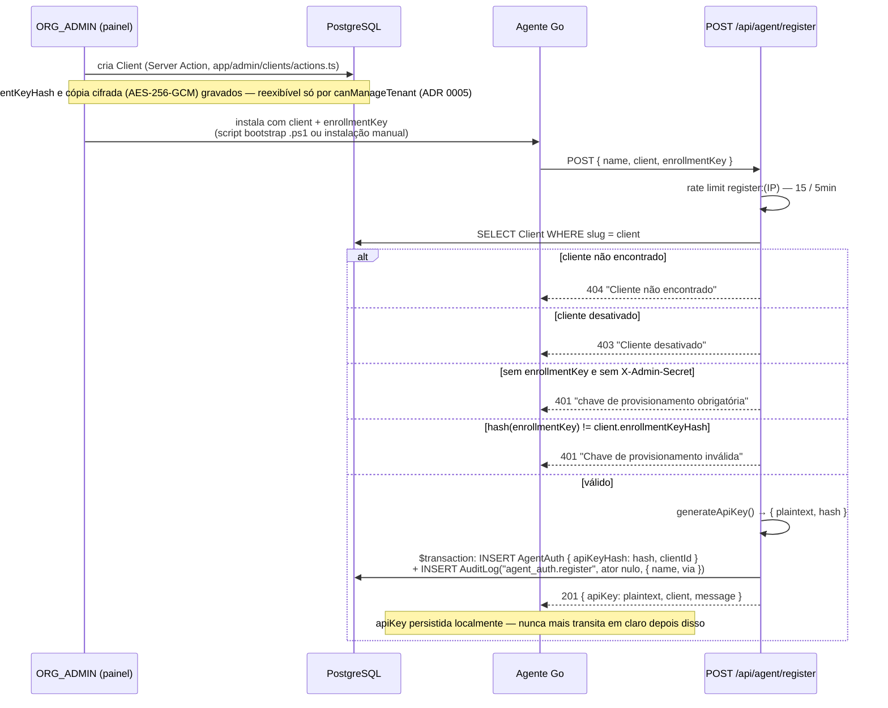
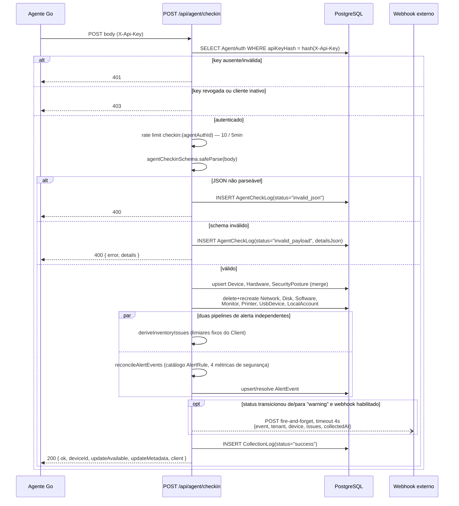
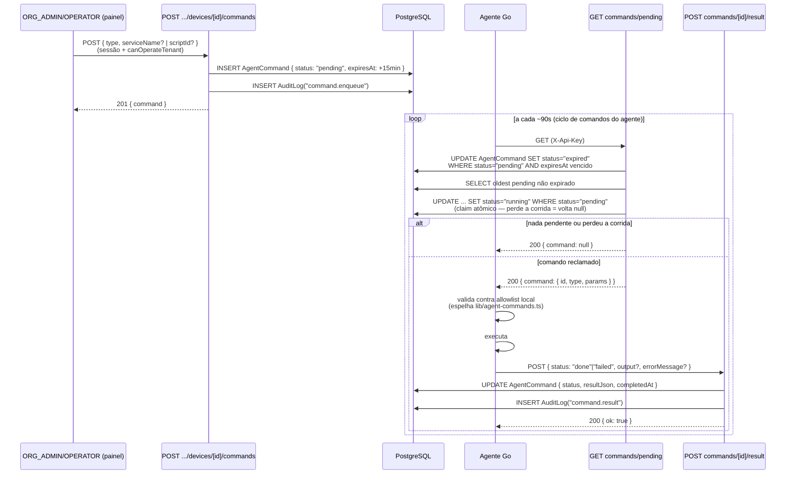

# SPEC.md — Especificação Técnica

> Complementa [`PRODUCT.md`](./PRODUCT.md) (requisitos/RBAC/inventário de rotas) e
> [`PRODUTO.md`](./PRODUTO.md) (modelo de negócio/plano). Este documento cobre o nível abaixo:
> diagramas de sequência dos 3 fluxos principais, contrato completo de cada rota de API do
> agente, toda regra de validação Zod, e a estratégia de segurança (autenticação, autorização,
> criptografia, rate limiting). Todo trecho de código abaixo foi lido diretamente do arquivo
> citado — nada é hipotético. Onde uma escolha de segurança merece nota (ex.: hash sem sal), a
> nota está no texto, não escondida.

---

## 1. Diagramas de sequência

### 1.1 Enrollment — de `enrollmentKey` a `apiKey`



`Device` **não** é criado no enrollment — só `AgentAuth`. O primeiro `Device` nasce no primeiro
check-in bem-sucedido (`prisma.device.upsert` por `agentAuthId`), não aqui.

### 1.2 Check-in completo (ciclo de 1h)



Note a `par`: as duas pipelines de alerta rodam na mesma requisição mas não compartilham tipo nem
armazenamento — ver Achado 1 do architecture review desta sessão (`deriveInventoryIssues` é
efêmera e vira `Device.status`; `reconcileAlertEvents` persiste `AlertEvent`).

### 1.3 Comando remoto — enfileirar, buscar, executar, reportar



Catálogo fechado (`lib/agent-commands.ts`): `collect_now`, `collect_metrics_now`,
`restart_service` (allowlist de 4 serviços), `run_script` (allowlist de 4 scripts),
`restart_computer` — nunca texto livre. TTL de 15 minutos (`AGENT_COMMAND_TTL_MS`) contado a
partir do enfileiramento, não da entrega ao agente.

---

## 2. Contratos de API — rotas do agente

Todas usam `X-Api-Key` exceto `register` (enrollmentKey ou `X-Admin-Secret`) e `bootstrap`
(`client`/`key` na query string, não conferidos contra registro nesta rota — ver §4).

### `POST /api/agent/register`

| | |
|---|---|
| Request | `{ name: string (min 3), client?: string (min 2), enrollmentKey?: string (min 16) }` |
| 201 | `{ id, name, client: {id,name,slug}, apiKey: <plaintext>, message }` — única vez que `apiKey` aparece em claro |
| 400 | `{ error: <primeira mensagem do zod> }` |
| 401 | `{ error: 'A chave de provisionamento do cliente é obrigatória.' }` ou `{ error: 'Chave de provisionamento inválida.' }` |
| 403 | `{ error: 'Cliente desativado.' }` |
| 404 | `{ error: 'Cliente não encontrado...' }` |
| 429 | `{ error: 'Muitas requisições...' }`, header `Retry-After` |
| 500 | `{ error: 'Erro interno no servidor.' }` |

### `POST /api/agent/checkin`

| | |
|---|---|
| Request | `agentCheckinSchema` completo — ver §3.1 |
| 200 | `{ ok: true, deviceId, updateAvailable: boolean, updateMetadata: {version,url,sha256}\|null, client: {id,name,slug}\|null }` |
| 400 | `{ error: 'Payload inválido.' }` (JSON quebrado) ou `{ error: 'Payload inválido ou excede o limite de recursos.', details }` (zod) |
| 401/403 | `{ error: <mensagem de validateAgentApiKey> }` |
| 429 | `{ error }`, header `Retry-After` |
| 500 | `{ error: 'Erro interno no servidor.' }` |

`updateAvailable` = `agentVersion !== "1.0.0"` (versão mais recente hardcoded no handler).

### `POST /api/agent/metrics`

| | |
|---|---|
| Request | `agentMetricsSchema` — ver §3.2 |
| 200 | `{ ok: true }` |
| 202 | `{ ok: false, reason: 'device_not_registered' }` — checkin ainda não rodou pra este agente |
| 400 | `{ error: 'Payload inválido.' }` (+ `details` se falha de zod) |
| 401/403 | `{ error }` |
| 429 | `{ error }`, header `Retry-After` |

Expurgo por retenção roda inline em toda chamada bem-sucedida (`Client.metricsRetentionDays`,
default 90).

### `GET /api/agent/commands/pending`

| | |
|---|---|
| Request | nenhum body |
| 200 | `{ command: null }` ou `{ command: { id, type, params } }` |
| 401/403 | `{ error }` |
| 429 | `{ error }`, header `Retry-After` |

### `POST /api/agent/commands/[id]/result`

| | |
|---|---|
| Request | `agentCommandResultSchema` — ver §3.3 |
| 200 | `{ ok: true }` |
| 400 | `{ error: 'Payload de resultado inválido.', details: <zod .flatten()> }` |
| 404 | `{ error: 'Comando não encontrado.' }` |
| 401/403 | `{ error }` |
| 429 | `{ error }`, header `Retry-After` |

### `GET /api/agent/bootstrap`

| | |
|---|---|
| Request | query string `?client=&key=` — validados pelo schema compartilhado `provisioningParamsSchema` (`lib/provisioning.ts`, ver §3.6) |
| 200 | texto plano (script PowerShell), `Content-Disposition: attachment` |
| 400 | `{ error: 'Parâmetros client e key ausentes ou fora do formato permitido.' }` — `client`/`key` ausente **ou fora da allowlist** (§3.6); nenhum script no corpo |
| 500 | `{ error: 'Não foi possível gerar o script de instalação.' }` — URL do servidor (env ou cabeçalhos `x-forwarded-host`/`host`) inválida para interpolação no script; nenhum script no corpo |
| 503 | `{ error }` — `public/inventario-agent.exe` não publicado (sem SHA-256 a conferir); avaliado depois do `400` e antes de montar o script; nenhum script no corpo (Sprint A4, N6) |
| 429 | `{ error }`, header `Retry-After` |

O script confere `(Get-FileHash -Algorithm SHA256 -Path $downloadPath).Hash` contra o hash publicado logo depois do `Invoke-WebRequest` e antes de qualquer execução do arquivo baixado; divergência → `Remove-Item` e `throw` com esperado e obtido.

### `GET /api/agent/bootstrap-linux`

| | |
|---|---|
| Request | query string `?client=&key=` — `provisioningParamsSchema` (§3.6) |
| 200 | script bash, `Content-Type: text/plain; charset=utf-8`, `Content-Disposition: attachment; filename="install-{client}.sh"`, `Cache-Control: no-store` |
| 400 | `{ error: 'Parâmetros client e key ausentes ou fora do formato permitido.' }`; nenhum script no corpo |
| 503 | `{ error }` — `public/inventario-agent-linux` não publicado; nenhum script no corpo |
| 500 | `{ error: 'Não foi possível gerar o script de instalação.' }` — URL do servidor fora da allowlist |
| 429 | `{ error }`, header `Retry-After` |

Uso: `curl -fsSL '<url>' | sudo bash`. O script (`buildLinuxBootstrapScript`) roda dentro de `main()`, com `set -euo pipefail`; exige `id -u` = 0; baixa `${server}/inventario-agent-linux` para `mktemp -d` (apagado por `trap`) com `curl -fsSL` ou `wget -qO`; confere o hash com `sha256sum` ou `shasum -a 256`; sem ferramenta de download, sem ferramenta de hash ou com hash divergente sai com código ≠ 0 sem instalar. Nada é executado do diretório temporário: o binário vai para `/usr/local/bin/inventario-agent`, e só então roda `uninstall` (se `/etc/systemd/system/inventario-agent.service` existir) e `install -server … -client … -key … -name "$(hostname)"`.

### `GET /api/agent/download-linux`

| | |
|---|---|
| Request | query string `?client=&key=` — `provisioningParamsSchema` (§3.6) |
| 200 | binário Linux (amd64) + bloco `\n<<INV_CONFIG>>{serverUrl,client,key}<<INV_CONFIG>>\n` (o mesmo de `download-exe`), `application/octet-stream`, `Content-Disposition: attachment; filename="inventario-agent-{client}"`, `Cache-Control: no-store`, `Content-Length` |
| 400 | `{ error: 'Parâmetros client e key ausentes ou fora do formato permitido.' }`; nenhum byte de binário |
| 503 | `{ error }` — binário Linux não publicado |
| 429 | `{ error }`, header `Retry-After` |

### `POST /api/tenant/[clientSlug]/devices/[deviceId]/commands` (enfileirar — sessão de usuário, não agente)

| | |
|---|---|
| Auth | sessão + `canOperateTenant` |
| Request | `agentCommandInputSchema` — ver §3.4 |
| 201 | `{ ok: true, command: { id, type, status } }` |
| 400 | `{ error: 'Comando inválido.', details: <zod .flatten()> }` |
| 403 | `{ error: 'Você não pode enfileirar comandos neste tenant.' }` |
| 404 | `{ error: 'Máquina não encontrada.' }` |

### `GET /api/tenant/[clientSlug]/devices/[deviceId]/commands` (histórico)

| | |
|---|---|
| Auth | sessão + `canAccessTenant` (mais permissivo que o POST — leitura é para qualquer papel que veja o tenant) |
| 200 | `{ commands: AgentCommand[] }` — últimos 50, mais recente primeiro |
| 403 | `{ error: 'Acesso não autorizado.' }` |
| 404 | `{ error: 'Máquina não encontrada.' }` |

---

## 3. Regras de validação Zod

### 3.1 `lib/schemas/agent-checkin.ts` — `agentCheckinSchema`

```ts
hostname: z.string().min(1).max(255)                    // obrigatório
agentVersion, serial, fabricante, modelo, dominio, usuario: z.string().max(255).optional().nullable()

sistema, versaoSO, processador, slot1..slot4, placaMae, tipoArmazenamento:
  z.string().max(255).optional().nullable()
ramTotalGb: z.number().int().optional().nullable()

redes:            z.array(networkSchema).max(20).optional().default([])
discos:           z.array(diskSchema).max(20).optional().default([])
software:         z.array(softwareSchema).max(2000).optional().default([])
seguranca:        securitySchema.optional().nullable()   // sem default — fica undefined se omitido
contasLocais:     z.array(localAccountSchema).max(200).optional().default([])
monitores:        z.array(monitorSchema).max(20).optional().default([])
impressoras:      z.array(printerSchema).max(50).optional().default([])
dispositivosUsb:  z.array(usbDeviceSchema).max(200).optional().default([])
eventLogs:        z.array(eventLogSchema).max(500).optional().default([])
```

Sub-schemas:

```ts
networkSchema: { ip?, mac?, gateway?, dns?: string.max(≤255); dhcp?, isPrimary?: boolean }
diskSchema: { unidade?, modelo?, tipo?: string; capacidadeGb?, espacoLivreGb?: int;
              criptografia?: enum('on'|'off'|'unknown') }
securitySchema: { antivirusNome?: string; antivirusAtivo?, antivirusAtualizado?, firewallAtivo?,
                  secureBootAtivo?, tpmPresente?, uacAtivo?: boolean; observacao?: string.max(500) }
localAccountSchema: { usuario: string.min(1).max(255) (obrigatório);
                       isAdmin=false, habilitada=true, senhaNuncaExpira=false: boolean }
softwareSchema: { nome: string.min(1).max(255) (obrigatório); versao?, editor?, installadoEm? }
monitorSchema: { fabricante?, modelo?, serial?: string; polegadas?: number.max(500);
                  conexao?: string; ano?: int.min(1990).max(2100) }
printerSchema: { nome: string.min(1) (obrigatório); porta?, driver?: string;
                  padrao=false, deRede=false: boolean }
usbDeviceSchema: { nome: string.min(1) (obrigatório); vendorId?, productId?, serial? }
eventLogSchema: { source?, level?, message?, timeCreated?: string; eventId?: int } .passthrough()
```

**Comentários originais no código, relevantes para entender o design:**
- Todo booleano de `securitySchema` é opcional e nulável *de propósito*: ausente/nulo significa
  "não apurado", nunca "desativado" — Windows Server sem o namespace `SecurityCenter2` reporta
  antivírus/firewall como nulos mesmo protegido.
- O limite de `software` foi subido de 300 para 2000 depois de um incidente real: uma estação
  Windows comum passa de 300 programas instalados, e estourar o limite antigo rejeitava o
  check-in **inteiro** (400), não só a lista de software.

### 3.2 `lib/schemas/agent-metrics.ts` — `agentMetricsSchema`

```ts
hostname: string.min(1).max(255)                         // obrigatório
agentVersion?: string.max(50)
cpuPercent?: number.min(0).max(100)
ramUsadaGb?, ramTotalGb?: number.min(0).max(100_000)
discoUsadoGb?, discoLivreGb?: number.min(0).max(1_000_000)
uptimeSegundos?: int.min(0)
```
Todos os numéricos são `.optional().nullable()`.

### 3.3 `lib/agent-commands.ts` — `agentCommandResultSchema`

```ts
status: z.enum(['done', 'failed'])         // obrigatório
output?: string.max(20_000)
errorMessage?: string.max(2_000)
```

### 3.4 `lib/agent-commands.ts` — `agentCommandInputSchema` (union discriminada por `type`)

```ts
{ type: 'collect_now' }
{ type: 'collect_metrics_now' }
{ type: 'restart_service', serviceName: enum('Spooler','wuauserv','BITS','Dnscache') }
{ type: 'run_script', scriptId: enum('flush_dns','clear_temp_files','restart_explorer','flush_print_spooler') }
{ type: 'restart_computer' }
```

Comentário original: *"v1: catálogo restrito de tipos/params, deliberadamente sem 'run arbitrary
text'... Expandir aqui e no agente juntos, nunca só de um lado."* — a allowlist é espelhada
manualmente em `agent-go/internal/app/commands/service.go`, sem link de compilador entre as duas
(ver ADR candidato, seção 4 do architecture review desta sessão).

### 3.5 `POST /api/agent/register` — schema inline

```ts
name: string.min(3)
client?: string.min(2)
enrollmentKey?: string.min(16)
```

### 3.6 `GET /api/agent/bootstrap`, `bootstrap-linux`, `download-exe` e `download-linux` — schema compartilhado

`provisioningParamsSchema` em `lib/provisioning.ts`, importado pelas quatro rotas (nenhuma define a
regex inline). Allowlist estrita: entrada fora do formato é **rejeitada** com `400`, nunca
sanitizada.

```ts
client: string.trim().min(2).max(64).regex(/^[a-z0-9-]+$/)
key: string.trim().regex(/^[a-zA-Z0-9_-]{16,128}$/)
```

Defesa em profundidade: `buildBootstrapScript` e `buildProvisioningArtifacts` lançam erro para
`client`/`key` fora da mesma allowlist e para `serverUrl` não parseável, com protocolo diferente de
`http`/`https`, ou contendo aspas (ASCII `'`/`"` e U+2018–U+201B), backtick, `$` ou caractere de
controle (incluindo `\r`/`\n`).

Sprint A4: `buildLinuxBootstrapScript` aplica a mesma allowlist e, como segunda camada, interpola
os valores entre aspas simples com `escapeBashSingleQuoted` (`'` → `'\''`). O `linuxInstallCommand`
usa aspas duplas de bash, por isso a recusa de `$` e backtick no `serverUrl` é obrigatória. O hash
esperado (`expectedSha256`) é obrigatório em `buildBootstrapScript` e `buildLinuxBootstrapScript` e
validado por `/^[a-f0-9]{64}$/` antes de entrar em qualquer script.

---

## 4. Estratégia de segurança

### 4.1 Autenticação — três mecanismos, sem sobreposição

| Mecanismo | Onde | Header/campo | Verificação |
|---|---|---|---|
| Sessão NextAuth | páginas `/app/*`, `/admin/clients`, `/portal/*`, rotas de API tenant-scoped | cookie de sessão | `auth()` + guard de `lib/permissions.ts` por rota |
| `X-Api-Key` | todas as rotas `/api/agent/{checkin,metrics,commands/*}` | header `X-Api-Key` | `validateAgentApiKey` — hash SHA-256 do valor recebido, lookup exato em `AgentAuth.apiKeyHash` |
| `X-Admin-Secret` | `register` (caminho alternativo), `/api/inventory/computers` | header `X-Admin-Secret` | comparação `===` contra `process.env.ADMIN_SECRET` |

**Nenhuma comparação de segredo no código usa `crypto.timingSafeEqual`** — nem o admin secret
(`===`), nem o `enrollmentKey` (comparação de hash via `!==`), nem a lookup de `apiKey` (delegada
à igualdade exata do índice único do Postgres). Para segredos de alta entropia (256 bits
aleatórios) isso é uma exposição teórica a timing attack, não prática — mas é uma escolha, não
um esquecimento, e vale registrar como tal.

### 4.2 Autorização — dois níveis, um coarse e um definitivo

1. **Proxy** (`proxy.ts`, ex-`middleware.ts` — convenção renomeada no Next.js 16, roda antes de qualquer coisa, sem acesso a banco):
   redireciona não-autenticado para `/login`; bloqueia `CLIENT_VIEWER` fora de `/portal`; chama
   `canPossiblyAccessTenantSlug` como portão grosseiro para `/app/*` (só confirma que o
   usuário *tem* uma `organizationId`, não que ela é dona daquele slug); bloqueia área de conta
   (`/admin/clients`, `/users`) e área de plataforma (`/security`) por papel; redireciona 308 as
   URLs antigas `/tenant/[slug]/*` e `/clients` para os prefixos atuais (Sprint 5).
2. **Guard definitivo por página/rota**, com acesso a banco: `requireTenantContext()` (ADR 0004)
   para todo `/app/[clientSlug]/*`; `canAccessTenant`/`canOperateTenant`/`canManageTenant` (e
   os que delegam neles) chamados explicitamente em cada rota de API tenant-scoped.

O comentário do próprio middleware é explícito sobre a divisão: *"Portao GROSSEIRO... A
autorizacao definitiva acontece em requireTenantContext."* Ver matriz completa de papéis×ação em
`PRODUCT.md` §7.

### 4.3 Criptografia — três padrões, cada um calibrado ao segredo que protege

| Segredo | Algoritmo | Onde | Por quê é o padrão certo aqui |
|---|---|---|---|
| Senha de usuário (`User.passwordHash`) | **bcrypt** (`bcryptjs`, `auth.ts`) | login | Segredo de baixa entropia escolhido por humano — precisa de salt + custo computacional para resistir a rainbow table e força bruta. |
| `apiKey` / `enrollmentKey` (`AgentAuth.apiKeyHash`, `Client.enrollmentKeyHash`) | **SHA-256 sem sal** (`hashSecret`, `lib/auth.ts`) | credencial de agente | Segredo de **alta entropia** — 32 bytes aleatórios de `crypto.getRandomValues` (256 bits), gerado pelo servidor, nunca escolhido por humano. Sal protege contra ataque de dicionário/rainbow table em segredos previsíveis; um valor de 256 bits aleatórios não precisa disso. Usar bcrypt aqui seria custo sem benefício (bcrypt trunca em 72 bytes e é pensado para *lentidão* contra tentativa de senha, não para isto). |
| Chave de provisionamento ativa (reexibição temporária no painel) | **AES-256-GCM**, IV aleatório de 12 bytes por registro, chave via `scryptSync(segredo mestre, salt fixo, 32)` (`lib/provisioning-credentials.ts`) | `Client.activeProvisioningKeyEnc` | É **criptografia reversível** (o painel precisa reexibir a chave), não hash — categoria diferente das duas linhas acima. O salt do `scrypt` é fixo (`KEY_SALT` hardcoded) porque ele deriva a *chave simétrica única do processo* a partir de uma variável de ambiente, não protege N segredos de usuários diferentes — não é o mesmo papel que um salt de hash de senha. |

Ordem de resolução do segredo mestre: `INVENTARIO_PROVISIONING_SECRET` → `AUTH_SECRET` →
`ADMIN_SECRET` (primeiro definido vence); lança erro se nenhum existir. Payload armazenado como
JSON `{v, iv, tag, ciphertext}` em base64url; `v` é validado na descriptografia (rejeita versão
desconhecida).

### 4.4 Rate limiting

Implementação em `lib/rate-limit.ts`: janela fixa em memória de processo (`Map`), sem Redis, sem
persistência entre restarts, **não compartilhada entre instâncias horizontais** — limitação
documentada explicitamente no próprio arquivo, não uma surpresa a descobrir em produção.

| Rota | Chave | Limite | Janela |
|---|---|---|---|
| `register` | IP do cliente | 15 | 5 min |
| `checkin` | `agentAuthId` | 10 | 5 min |
| `metrics` | `agentAuthId` | 20 | 5 min |
| `bootstrap` | IP do cliente | 20 | 5 min |
| `download` | IP do cliente | 20 | 5 min |
| `download-exe` | IP do cliente | 20 | 5 min |
| `bootstrap-linux` | IP do cliente | 20 | 5 min |
| `download-linux` | IP do cliente | 20 | 5 min |
| `commands/pending` | `agentAuthId` | 60 | 5 min |
| `commands/[id]/result` | `agentAuthId` | 30 | 5 min |

Rotas pós-autenticação chaveiam por `agentAuthId` (limita **um** agente comprometido, não um IP
atrás de NAT compartilhado com agentes legítimos); rotas pré-autenticação (`register`,
`bootstrap`, `download*`) só têm IP disponível.

### 4.5 Isolamento multi-tenant

Ver ADR [0004](./adr/0004-tenant-isolation-fail-closed.md) e ADR
[0001](./adr/0001-device-identity-by-agentauthid.md) (`CONTEXT.md` define os termos). Resumo:
fail-closed via `notFound()` (nunca revela existência de tenant de outra organização),
`clientId` denormalizado em `Device`/`MetricSample`/`AgentCommand` para isolamento virar filtro
de índice em vez de JOIN.

---

## Cobertura desta especificação

Lido integralmente para este documento: os 8 `route.ts` sob `app/api/agent/**` e o par
`app/api/tenant/[clientSlug]/devices/[deviceId]/commands/route.ts`; `lib/schemas/agent-checkin.ts`,
`lib/schemas/agent-metrics.ts`, `lib/agent-commands.ts`, `lib/auth.ts`,
`lib/provisioning-credentials.ts`, `lib/rate-limit.ts`, `proxy.ts`, `auth.ts` (só a parte de
bcrypt). Não lido nesta passada: `lib/portal-context.ts`, o restante de `auth.ts`
(providers/callbacks completos), código Go além do já citado nos ADRs.
